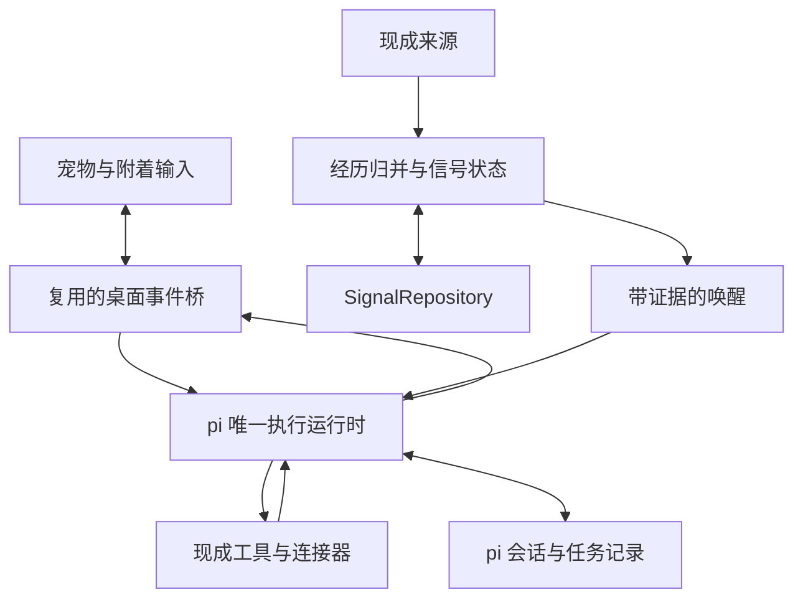

**方案目标：一只能够替用户做事、由信号累积驱动主动性的桌面宠物。** 默认优先 fork AIRI 桌面端，复用身体、输入、语音和桌面基础设施；通过无 TUI 的 pi SDK 承担唯一的对话与任务执行主循环。Signal Engine 将持续观察转为有证据的唤醒。

用户只与宠物交互：交代任务、追加要求、查看成果、聊天和更正认识。没有预设具体关注目标时，它仍可从日常经历中发现重复模式；已经明确委托的条件任务，达到信号条件后可以直接推进。状态维护不周期性调用模型询问“现在要不要做什么”。

版本 0.2 · 2026-10-19。第一版同时交付宠物、Agent 办事能力与最小信号回路；不设计安静陪伴、暂停观察、隐藏宠物这组模式。本页保留技术背景，具体产品和验收以[研究概念](https://chatgpt.com/space/page_69fd36d483a08191af3cdcd820b01f65)与[工程 Spec](https://chatgpt.com/space/page_394cbfb422c081918dbbaa7e92311329)为准。

# 组件选择与复用边界

| 层次 | 默认组件 | 直接复用 | 必要新增或修改 |
| - | - | - | - |
| 宠物身体与交互 | AIRI 桌面端为首选 fork 候选 | 窗口、角色、输入、字幕、语音、打包 | 收敛为宠物入口，连接执行状态与成果 |
| 对话与执行 | pi SDK，无 TUI | 模型和工具循环、会话、队列、扩展 | 一个 AgentRuntimeAdapter，关联任务与信号 |
| 来源 | 现成文件 watcher、AIRI 插件与所需连接器 | 既有采集和服务访问 | 统一观察、增量更新和真实经历归并 |
| 状态更新 | 普通 TypeScript 函数与既有事件机制 | 事件传递、调度 | 持续增益、时间衰减、阈值和语义记录 |
| 持久化 | pi SessionManager 与独立 SignalRepository | 会话存储；优先复用上游本地存储 | episode、状态、outbox 与任务触发关联 |
| 补充组件 | ActivityWatch、RxJS、SQLite、Node-RED 或 River | 仅在有明确能力缺口时采用 | 不为了技术栈完整而全部加入 |

pi SDK 能在 Node/Bun 中直接承载 Agent，工具结果可以使执行继续进入后续模型回合。宠物输入、系统唤醒和任务追加共用这个主运行时；AIRI 的原始生成分支要接到同一入口，避免两套会话和模型串联。[pi SDK](https://pi.dev/docs/latest/sdk) · [运行机制](https://pi.dev/docs/latest/how-pi-works)

AIRI 已有桌面应用与 context bridge，可复用 input、context 和 spark 等事件入口。首版仍需改造这些入口的生成责任，并核对一个候选只被一个窗口消费。[AIRI](https://github.com/moeru-ai/airi) · [context-bridge.ts](https://github.com/moeru-ai/airi/blob/main/packages/stage-ui/src/stores/mods/api/context-bridge.ts)

先审查上游已有存储能否原子提交观察处理、状态和待派发记录，能用就扩展相应命名空间。pi 会话作为对话和工具记录的事实源；信号存储通过稳定 ID 与其连接，不声称两个存储天然具有跨库事务。仅在实际缺口存在时加入 SQLite 等成熟后端。

# 总体数据流



观察路径只做短计算和持久写入；执行路径消费用户任务和合格信号，复用 pi 的模型与工具循环。执行期间仍能收集新观察。任务产生的结果回到同一个宠物，用户无需转到另一个 Agent 界面。

心跳可以承担增量拉取、来源健康检查、过期候选处理和时间更新。心跳本身不代表用户又做了一次行为，也不默认触发模型。真实事件和心跳都可以推动状态，但它们的增益语义不同。

# 首版怎样收集信号

## 聊天与主动记录

从宠物的既有输入接收行为陈述、任务、态度和更正。例如“今天午饭吃了菠萝”形成一次食用观察；“我明天想吃菠萝”属于计划；“朋友吃了菠萝”属于另一主体。任务交代进入真实执行路径，而不只被抽取成记忆。

第一版对有限领域的明确陈述做可靠抽取，用户照常对宠物说话。一般自然语言复用正常对话中已经得到的结构化结果；若观察到主回复后才形成，则参与后续时机。用户不必掌握命令、进入结构化管理表或先声明关注某个实体。

一次记录包含来源和证据。照片中出现菠萝、页面标题包含菠萝、买过菠萝，都不能直接记为本人吃过菠萝。

## 桌面与浏览器活动

优先沿用 AIRI 浏览器插件和已有来源；只有需要应用、窗口、停留及 AFK 覆盖时再加入 ActivityWatch。自动数字活动以稳定资源标识形成观察，语义主题归类按需求扩展，不让模型逐条读取全部窗口记录。[AIRI 浏览器插件](https://github.com/moeru-ai/airi/blob/main/plugins/airi-plugin-web-extension/README.md) · [ActivityWatch watchers](https://docs.activitywatch.net/en/latest/watchers.html)

ActivityWatch 会把相邻且数据相同的 heartbeat 合并为一个 event，并延长其 duration。因此适配器按 `bucket_id + event_id` 更新已有事件，读取新增时长，或进一步归并独立访问经历。不能每次轮询都增加一次访问。[事件与 heartbeat](https://docs.activitywatch.net/en/latest/buckets-and-events.html)

增量读取保留重叠窗口，并持续刷新最后一个仍在增长的事件。单纯记住最新 timestamp 后只取更晚事件，会漏掉已有事件的 duration 更新。拉取频率只影响发现延迟，不应改变同一组真实行为的最终得分。

窗口 watcher 的平台支持需要随实际设备核对；官方对 Linux X11 与 Wayland 列出了不同路径。实际安装后也应按本机 API 版本确认字段。[Watcher 平台说明](https://docs.activitywatch.net/en/latest/watchers.html) · [API 版本说明](https://docs.activitywatch.net/en/latest/api/rest.html)

## 扩展入口

统一观察契约连接现成文件 watcher、插件和第三方连接器。文件产生多次底层通知时，按真实身份与内容修订处理。为委托任务累计资料时使用“委托 + 输入范围”的聚合键，独立文件作为 episode；任务输出不重新计入输入。

# 统一观察协议

核心字段要把“收到一条消息”和“发生一次行为”分开。下面是建议的内部数据形状，字段名称在实现时可以调整。

```json
{
  "observation_id": "obs_chat_104",
  "source": "pet_chat",
  "source_event_id": "message_104",
  "occurred_at": "2026-10-19T12:10:00+08:00",
  "received_at": "2026-10-19T12:11:00+08:00",
  "subject": "self",
  "action": "eat",
  "entity": "food:pineapple",
  "context": {"meal": "lunch"},
  "assertion": "actual",
  "episode_id": "meal_20261019_lunch",
  "evidence_ref": "message_104",
  "extraction": "explicit_user_record"
}
```

`episode_id` 可以先缺省，由归并器补上。同一次午餐的聊天、食物记录和照片可以成为多份证据，但只构成一次食用经历。跨来源无法可靠确认是同一经历时，保留不确定性，采用保守计数；不要伪造精确的统一标识。

归一化首先处理主体、实际发生与计划、否定、动作类型和实体别名。食用、购买、浏览和喜欢分别保存。一个来源重送相同记录，直接识别为已处理；相隔几天的两次相同食用内容，则应保留为两次经历。

更正通过撤回或替代关系关联原观察。“其实那是给朋友买的”可以使原判断失效。系统自己的推断和发言不会被当作新的用户行为证据；用户随后明确确认偏好，可以形成新的偏好证据。

# 用一个通用检测器形成动态状态

## 维度随观察生成

首版用通用 repeated_behavior 处理重复经历，按 subject + action + entity 自动建立状态行；菠萝、其他食物或项目复用同一检测器。明确的“每三份新资料整理一次”委托，使用按输入集合累积的计数条件，不套用食用经历的衰减参数。

逻辑上，这已经是一张稀疏的特征矩阵：每个行为对象是一行，近期有效经历、停留时长、主动选择、正负反馈和最后表达状态是不同列。第一版只启用有可靠数据支撑的列，后续在相同数据结构上加入关联特征。

## 稳定的更新接口

```ts
step(previousState, observation, detectorConfig)
// 返回 nextState 和可选的 wakeCandidate
```

函数只处理状态转移，不直接调用模型、发通知或读写多个外部系统。数据库事务负责读取当前状态并保存返回结果，便于固定时间回放和修正。

事件型证据采用真实时间衰减的加权累积，示意为：

`score = oldScore × 2^(-elapsed / halfLife) + newEpisodeGain`

这里只对新的独立经历增加增益。持续测量的数值或停留时长采用相应的时间积分或窗口统计。迟到事件按实际发生时间折算到当前状态；不能把几周前的导入记录当成刚发生的新事件。

状态函数与事件库、存储解耦。普通去重算子不能取代 episode 去重，普通时间窗口也不能自动解决事件乱序。先复用所选仓库已有机制，只有需要时增加相应库；无需重建通用流处理框架。

## 阈值提供发起理由

重复食用首先增加“最近反复吃这个东西”的显著性，可以支持“你好像挺喜欢菠萝？”的试探。主动选择、正面评价和确认继续加强偏好认识。任务信号还必须带着已有委托；偏好发现与替用户执行操作分别判断。

不要把显著性分数直接标为“喜欢概率”。没有建模选择机会、替代项和反馈时，次数并不等于偏好强度。喜欢的明确证据也应与是否值得此刻开口分开保存。

# 菠萝场景的完整行为

用一组演示参数检验路径：每个独立食用经历增益为 1，半衰期为 7 天，上阈值为 3.2，四次行为各间隔一天。参数用于验证机制，不代表已经校准的人类偏好模型。

| 时机 | 独立经历数 | 更新后分数 | 系统动作 |
| - | - | - | - |
| 第一次 | 1 | 1.000 | 留下观察 |
| 第二次 | 2 | 1.906 | 更新状态 |
| 第三次 | 3 | 2.726 | 更新状态 |
| 第四次 | 4 | 3.469 | 生成带证据的唤醒候选 |
| 第五次 | 5 | 4.142 | 保留新观察，已表达的同一发现受到抑制 |

第四次正在交谈时，证据进入同一个 pi 回合，由宠物直接说：“这几次你都吃了菠萝，你是不是挺喜欢它的？”不要求点击后才开口。

用户说“其实只是家里刚好买多了”，系统保存这个解释，并降低把重复行为解释为偏好的支持度。用户说“对，我很喜欢”，则保存明确的偏好证据。

表达后保留原始经历和状态，不通过清零制造下一轮相同提醒。半衰期只控制模式的当前活跃程度；历史经历和已经确认的偏好不会因为得分衰减而自动删除。

# 唤醒与任务怎样接入 Agent

## 有当前用户回合

已可靠结构化的当前输入先更新本地状态，把相关证据绑定到该输入，再由唯一的 AgentRuntimeAdapter 注入 pi 当前回合。用户同时交代的任务可以正常调用工具，不另加一次前置识别。

这一条路径不额外触发自主回合。任意文本如果仍需要模型理解，就复用当前正常对话中的抽取或异步结果，不串联一个每次都运行的前置识别模型。

## 来自后台的观察

独立候选持久化后，经适配器进入 pi：明确 source=signal，保留 candidateId、锚点和证据；任务用途还携带 mandateRef 与 triggerKey。真实会话正在执行时合并相关上下文或排队，使用对应版本的 steering/follow-up 能力。[pi SDK](https://pi.dev/docs/latest/sdk)

表达唤醒包包含触发原因、当前事件、证据、认识和有效期；任务唤醒额外关联委托、稳定输入批次和触发标识。以下是表达场景的简化示例，正式数据形状以工程 spec 为准：

```json
{
  "reason": "repeated_behavior_threshold",
  "pattern_key": "self/eat/food:pineapple",
  "anchor_observation": "obs_chat_104",
  "evidence_refs": ["obs_71", "obs_82", "obs_93", "obs_chat_104"],
  "interpretation": "repeated consumption",
  "expression_status": "not_yet_mentioned"
}
```

系统观察保持清楚来源。Agent 根据证据表达认识，或根据已有委托执行任务。已有授权的读取、整理、保存步骤直接推进；只有缺少必要信息或新的操作确需确认时，宠物才具体询问。

## 会话生命周期

首版直接使用无 TUI 的 pi SDK 会话，正常交谈与办事共用同一个运行时。宠物 UI 显示执行事件和结果；原有 AIRI 对话历史作为界面投影，不与 pi SessionManager 竞争模型上下文的事实源。

固定实际 pi 版本，使用运行完成和 agent_settled 等对应 API 核对结束；工具循环的某一次底层 agent_end 不代表整个任务完成。任务状态、工具回执和成果分别记录。[SDK 生命周期](https://pi.dev/docs/latest/sdk)

# 防止重复表达、重复执行与状态丢失

## 三类去重

检测器记录上穿与重新激活条件，避免阈值边缘抖动产生多个相同候选。当前主会话正在运行时保留并合并有用候选，使用真实运行状态协调，不建立用户忙闲模式。

表达记录判断某个认识是否已经说过，以及是否出现实质新增信息；不以每日配额或冷却结束决定重说。任务触发使用稳定 triggerKey 与封存输入批次，重试和重启不会自动产生一个新的执行资格。

旧数据导入可以建立模式状态，但默认静默。下一次相关实时事件到来时，再根据未表达状态决定是否提起。为此应区分“证据已经足够”和“曾经发起过表达”，不能仅依赖某一次瞬时上穿。

## 一个事务完成关键写入

持久化至少覆盖以下内容：

| 内容 | 用途 |
| - | - |
| 原始观察与经历关联 | 去重、证据回溯、更正与回放 |
| 信号状态与配置版本 | 恢复特征、阈值和锁存 |
| 候选、outbox 与已消费触发 | 合并候选，恢复与核对派发 |
| 已表达认识与反馈 | 语义去重，保留确认和更正 |
| pi 会话与工具记录 | 接续执行，核对真实工具结果 |
| 任务索引与成果 | 委托关联、进度、完成依据和产物位置 |

观察处理标记、模式更新与待派发记录在同一个信号存储事务中提交；执行在事务外进行，稳定候选或任务触发 ID 随运行保存。崩溃后先核对会话、工具结果和实际产物；不因为回执缺失就重做有副作用的操作。内部事务不能保证外部服务严格一次执行。

来源失联只说明观测覆盖有缺口，不能据此判断用户停止某种行为。恢复时保留实际发生时间，普通旧观察不集中触发过时表达；已有任务是否补做由原委托决定。

# 其他现成组件什么时候加入

| 组件 | 适合加入的条件 | 保持的边界 |
| - | - | - |
| 现成 MCP/CLI/API | 实际任务需要已有外部能力 | 复用真实工具执行器，接入同一 Agent |
| ActivityWatch | 上游来源缺少应用、窗口或有效停留覆盖 | 归一化观察，避免按拉取次数计数 |
| Node-RED | 多设备或外部来源映射工作显著增加 | 作为内部连接基础设施，用户仍与宠物交互 |
| River 或关联引擎 | 出现具体趋势、残差、多流窗口等检测需求 | 替换对应 detector，保留证据和派发契约 |
| Worker 扩展 | 实际任务具有可独立并行的子任务 | 同一成熟运行时按范围委派，由宠物统一交付 |

组件是否引入取决于能替代哪部分工作。Node-RED 可复用嵌入方式；pi SDK 的 MCP 扩展要显式装配。第一版不为了堆齐组件而新增运行时或独立服务。[Node-RED 嵌入](https://nodered.org/docs/user-guide/runtime/embedding) · [pi SDK](https://pi.dev/docs/latest/sdk)

River 的 `EWMean` 是指数加权均值。连续输入 1 不会形成 1、2、3 的证据总量，而且每次 update 的衰减因子不能自动代表真实时间间隔。因此它适合有明确统计含义的特征；本例的时间衰减事件总量仍需要对应的状态更新规则。[River EWMean](https://riverml.xyz/latest/api/stats/EWMean/)

复用优先落实到每项任务：直接复用已有能力，局部改造相近实现，缺少连接才加适配，缺少领域语义才新增。AIRI 与 pi 根代码当前为 MIT；素材和渲染依赖按各自条款选择。其他 GitHub 项目只要协议覆盖预期用途也可以使用，不人为限定许可证种类。[AIRI LICENSE](https://github.com/moeru-ai/airi/blob/main/LICENSE) · [pi LICENSE](https://github.com/earendil-works/pi/blob/main/LICENSE)

# 实施顺序与验收

## P0 验证现成底座

固定桌宠仓库和 Agent 版本，在真实目标设备构建；确认宠物输入能进入真实工具循环，系统信号也能进入同一运行时。记录存储、跨窗口权威、素材许可与必要修改，直接沿用上游打包。

P0 以 AIRI 身体与 pi 运行时为默认验证组合；若另一个允许修改的项目以更小成本满足等价能力，可以替换。不得用只有聊天或 tool schema 的实现充当通过验收的 Agent。

## P1 交付能办事的宠物

完成纯宠物交互、真实工具、多步骤任务、持久会话、最小信号、解释与更正。四条完整路径必须成立：整理资料生成真实文件；修改指定测试项目并运行已有验证；委托条件满足后自动整理资料；重复食用后自然表达并接受修正。

用户任务与信号任务共用执行入口。真正的成果由工具结果证明，宠物统一交付。用户不用进入终端、控制中心或第二套聊天界面。

## P2 至 P4 持续扩展

P2 扩充真实来源、经历归并和持续委托，按需验证一层 worker。P3 完善任务恢复、跨天记忆、语义去重与桌面可靠性并进行个人试用。P4 按研究证据扩展关联、情境唤回、工具和语音表现。

每阶段都沿已有仓库和稳定契约推进。后续增强不能成为推迟 P1 真实执行能力的理由；详细退出条件以工程 spec 为准。

# 第一版通过标准

| 检查情形 | 预期结果 |
| - | - |
| 按演示时间输入四次独立行为 | 第四次形成候选，分数与固定时间计算一致 |
| 相同 source event 重送多次 | 不增加经历数和增益 |
| 两次真实行为内容完全相同 | 仍计为两次经历 |
| 同一经历有多个可确认来源 | 只产生一次行为增益，保留多份证据 |
| 改变 heartbeat 或拉取频率 | 相同真实事件得到相同状态，允许发现延迟不同 |
| 数周前的事件刚导入 | 按实际时间计入，默认不立即发起 |
| 用户否定或更正旧观察 | 修正对应证据与状态，保留可回溯关系 |
| 当前用户输入使分数越阈值 | 在当前回合提供证据，不增加前置识别模型调用或额外自主回合 |
| 后台分数未达到发起条件 | 不产生额外的 agent run |
| Agent 正在回复 | 继续接收观察，候选等待或合并 |
| 同一发现已经表达 | 后续心跳或简单再上穿不会重复表达 |
| 进程重启 | 恢复状态，已确认完成的派发不重复执行 |
| 分数随时间衰减 | 历史观察和已确认偏好仍可查询 |
| 来源断连 | 标记观测缺口，不把缺口计为负面行为证据 |
| 宠物收到整理目录的任务 | 实际读取、写入并核对文件，交付可打开成果 |
| 宠物收到修改测试项目的任务 | 正确修改并运行已有验证，报告真实结果 |
| 事先委托三份新记录后生成摘要 | 独立输入计数达标后自动执行，结果不重新计入输入 |
| 执行中追加要求或取消任务 | 对应任务正确接续或停止，已发生操作如实保留 |
| UI 与内部状态审查 | 日常只与宠物交互，被排除模式没有后台残留 |

同时测量经历正确性、表达价值、任务完成质量、成果可用性和运行代价。模型请求按普通对话、任务工具循环与信号唤醒分项记录；不能把正常任务所需的多轮执行误计为前置理解浪费。

用户直接问宠物“你为什么这么说？”“这个任务做到哪了？”或“这个理解不对”，即可查看依据、进展或更正。状态矩阵、原始日志和回放留在开发诊断中，不提供 /signals、模式开关或管理后台作为日常使用前提。
