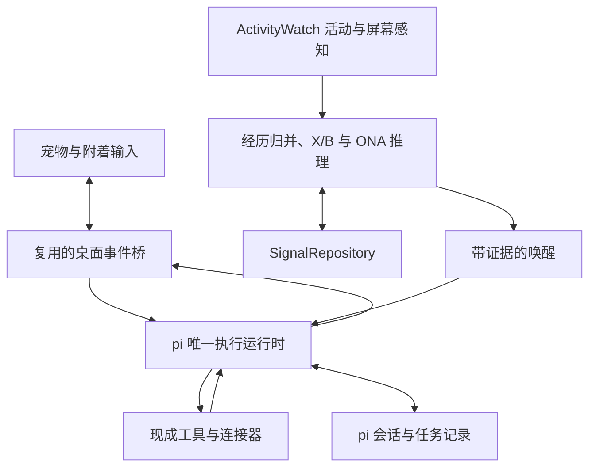

**方案目标：让持续积累的 Signal 在相关时刻参与 Personal Agent 的回答和实际办事，由同一只桌面宠物承载。** 默认优先 fork AIRI 桌面端，复用身体、输入、语音和桌面基础设施；通过无 TUI 的 pi SDK 承担唯一的对话与任务执行主循环。Signal Engine 将持续观察转为有证据的参与理由。

用户只与宠物交互：交代任务、追加要求、查看成果、聊天和更正认识。没有预设具体关注目标时，它仍可从日常经历中发现重复模式；已经明确委托的条件任务，达到信号条件后可以直接推进。状态维护不周期性调用模型询问“现在要不要做什么”。

版本 0.8 · 2026-10-19。第一版同时交付宠物、Agent 办事能力与信号回路；后台活动与屏幕感知是主入口，特征矩阵、跨对象关联与可修正的信号假设共同构成 Signal。重复计数仅作验证基线。不设计安静陪伴、暂停观察、隐藏宠物这组模式。本页保留技术背景，具体产品和验收以[研究概念](<桌面陪伴智能研究概念.md>)与[工程 Spec](<桌面陪伴宠物工程 Spec.md>)为准。

第一版引擎已选定为 OpenNARS for Applications（ONA）的声明式推理内核，累积、关联、反证、时间与触发契约见[Signal 实现决策与开工方案](<Signal 实现决策与开工方案.md>)。17 项合成机制检查与上游 C 测试通过，真实感知、参与价值及 Agent 交付仍须集成验收。BGE/embedding 不进入必需依赖。


Signal 的重点是跨经历累积：第一次记录，后续积累，某次相关交流中形成有依据的回应。对象从观察动态出现；用于抽取事件的规则不能直接变成关键词提醒，已经表达过的发现也不会在每次提及时重新宣布。Agent 使用这些证据理解当前请求，并在已有委托范围内行动。

完整私人助理后续需要贯通 memory，但 memory 属于独立毕业论文研究，当前不实现。观察、证据、更正、表达记录和任务持久化仅支撑当前信号闭环；时间衰减不等于记忆机制。不预建 memory 服务或算法，后续沿证据 ID、修订关系与现有 Agent 上下文入口接入，具体契约待论文方案明确后确定。

阅读导航：[复用边界](#组件选择与复用边界) · [信号来源](#首版怎样收集信号) · [信号形成](#从特征矩阵到信号形成) · [接入 Agent](#唤醒与任务怎样接入-agent) · [实施与验收](#实施顺序与验收)。

# 组件选择与复用边界

| 层次 | 默认组件 | 直接复用 | 必要新增或修改 |
| - | - | - | - |
| 宠物身体与交互 | AIRI 桌面端为首选 fork 候选 | 窗口、角色、输入、字幕、语音、打包 | 收敛为宠物入口，连接执行状态与成果 |
| 对话与执行 | pi SDK，无 TUI | 模型和工具循环、会话、队列、扩展 | 一个 AgentRuntimeAdapter，关联任务与信号 |
| 后台感知 | ActivityWatch + AIRI 屏幕捕获与视觉能力 | 活动 watcher、现成截帧与视觉模型接入 | 活动对齐、按变化理解当前窗口、结构化观察 |
| 补充来源 | 现成文件 watcher、AIRI 插件与所需连接器 | 既有采集和服务访问 | 统一观察、增量更新和真实经历归并 |
| 特征矩阵与信号 | SQLite 的 X/B + ONA 的证据修订与关系推理 + pi-ai 语义桥/参与评价 | 现成 NAL 推理代码、模型协议、事务存储 | 事实编译、有限快照、R/H 修订、当前机会与 Agent 连接 |
| 持久化 | pi SessionManager 与 SQLite SignalRepository | 会话存储与 better-sqlite3 事务 | episode、状态、outbox 与任务触发关联 |
| 补充组件 | Node-RED、River 等 | 仅在后续有明确能力缺口时采用 | 不进入第一版默认依赖 |

pi SDK 能在 Node/Bun 中直接承载 Agent，工具结果可以使执行继续进入后续模型回合。宠物输入、系统唤醒和任务追加共用这个主运行时；AIRI 的原始生成分支要接到同一入口，避免两套会话和模型串联。[pi SDK](https://pi.dev/docs/latest/sdk) · [运行机制](https://pi.dev/docs/latest/how-pi-works)

AIRI 已有桌面应用与 context bridge，可复用 input、context 和 spark 等事件入口。首版仍需改造这些入口的生成责任，并核对一个候选只被一个窗口消费。[AIRI](https://github.com/moeru-ai/airi) · [context-bridge.ts](https://github.com/moeru-ai/airi/blob/main/packages/stage-ui/src/stores/mods/api/context-bridge.ts)

SignalRepository 确定使用宿主侧 SQLite，以同一个事务提交观察处理、状态和待派发记录。pi 会话作为对话和工具记录的事实源；两个存储通过稳定 ID 与 outbox 连接，不声称天然具有跨库事务。AIRI 的界面持久化继续复用上游。

# 总体数据流



活动采集持续运行，屏幕语义提取异步进行；已经结构化的观察进入矩阵时只做短计算和持久写入。执行路径消费用户任务和合格信号，复用 pi 的模型与工具循环。执行期间仍能收集新观察。任务产生的结果回到同一个宠物，用户无需转到另一个 Agent 界面。

心跳可以承担增量拉取、来源健康检查、过期候选处理和时间更新。心跳本身不代表用户又做了一次行为，也不默认触发模型。真实事件和心跳都可以推动状态，但它们的增益语义不同。

# 首版怎样收集信号

## 主入口：后台活动与屏幕感知

宠物首先关注当前在做的事：正在看的项目、文章或页面，反复回到的资源，持续出现的主题，以及屏幕中可核对的错误或进展。应用时长是证据的一部分，不能独自说明用户在做什么。用户不用每天向宠物复述自己的活动。

ActivityWatch 从 P0 起接入，持续提供前台应用、窗口标题、时间区间及 AFK 状态；网址按实际窗口或浏览器 watcher 的能力取得。它提供活动轨迹，默认 watcher 不负责理解屏幕画面或正文。[ActivityWatch watchers](https://docs.activitywatch.net/en/latest/watchers.html)

内容理解优先使用已有来源提供的可见文本，没有合适文本时复用 AIRI 截取当前前台窗口，再由视觉模型提取对象、主题、可见事实和依据。AIRI 已有 Screen Capture 与 Vision Capture，但后者目前是开发页面中的 ticker，离开页面会停止；需要复用底层能力，改成独立于调试页面的后台采集，并将输出接到 Observation。[AIRI 屏幕与视觉捕获](https://airi.moeru.ai/docs/en/docs/contributing/desktop-developer-tools#screen-and-vision-capture)

感知由前台资源稳定停留、可见内容变化和用户明确询问当前画面推动。相同画面复用已有提取结果；滚动、窗口切换形成的新画面不自动算新经历。内容提取只回答“当前可见什么”，不操作工具。感知与后续信号推断分别记录成本；机械特征更新仍为零生成调用。具体采样参数、前台对齐和失败处理见工程 Spec。

ActivityWatch 会合并连续相同 heartbeat 并延长 event 的 duration。适配器按 `bucket_id + event_id` 更新，保留重叠读取并刷新仍在增长的最后事件。前台窗口、浏览器和 AFK 区间共同确定有效停留；重叠来源只覆盖同一段时间，不能重复加时长。AFK 是输入活动线索，不直接断言用户没有在阅读。[事件与 heartbeat](https://docs.activitywatch.net/en/latest/buckets-and-events.html)

屏幕中出现论文、菠萝图片或购物页面，只能支持“正在查看相关内容”。它不能证明读完论文、吃过菠萝、已经购买，也不能证明喜欢或焦虑。可靠资源键先进入矩阵；语义提取补充项目、主题和可见事实，模糊归类保留不确定性。

## 聊天补充任务、解释与更正

聊天承担交代任务、说明原因和纠正理解。例如“这几天看它是因为课题需要”改变对当前模式的解释；“把这些资料整理一下”进入真实执行路径。明确生活陈述也可作为补充观察，但不是后台信号成立的前提。

普通对话直接进入 pi，使用当时已形成的相关矩阵行与证据。若本轮之后才得到新的结构化观察，它只影响后续时机；不为每轮聊天增加前置识别。首版不要求实现通用聊天行为抽取器，更不能让用户手动喂观察来替代真实后台采集。

## 首发文件委托与扩展入口

统一观察契约连接现成文件 watcher、插件和第三方连接器。文件产生多次底层通知时，按真实身份与内容修订处理。为委托任务累计资料时使用“委托 + 输入范围”的聚合键，独立文件作为 episode；任务输出不重新计入输入。

P1 使用真实文件来源完成“每三份新会议记录生成摘要”。委托保存版本、用户请求依据、输入匹配范围、独立输出位置与启用时的已有文件基线；默认不把既有文件或同一文件修订算作新增份数。输入达到条件后原子封存批次，沿稳定触发键执行；完成后消费，结果不明时保留原批次核对。取消或修改委托使旧版本未开始的候选失效。详细字段与行为以工程 Spec 的“首发持续委托”为准。

# 统一观察协议

核心字段要把“采到一个样本”和“发生一次经历”分开。以下示例表示后台活动形成一次访问，后续语义结果关联相同 episode，不能再增加一次访问。正式字段以工程 Spec 为准。

```json
{
  "schemaVersion": 1,
  "observationId": "obs_aw_104",
  "sourceId": "aw:window:host1",
  "sourceEventId": "104",
  "sourceRevision": "2",
  "occurredAt": "2026-10-19T12:10:00+08:00",
  "receivedAt": "2026-10-19T12:12:00+08:00",
  "subject": "self",
  "action": "view",
  "entity": "resource:github.com/ActivityWatch/activitywatch",
  "assertion": "actual",
  "origin": "sensor",
  "ingestionMode": "live",
  "episodeId": "visit_20261019_12",
  "evidenceRef": "aw:window:host1/104@2",
  "activity": {
    "startedAt": "2026-10-19T12:10:00+08:00",
    "endedAt": "2026-10-19T12:12:00+08:00",
    "foregroundSeconds": 120,
    "activeSeconds": 100,
    "resourceKey": "resource:github.com/ActivityWatch/activitywatch"
  }
}
```

`episodeId` 可以先缺省，由归并器补上。同一次访问中的窗口事件、网页上下文和屏幕语义是多份证据，只构成一次访问经历。跨来源无法可靠确认是同一经历时，保留不确定性，采用保守计数；不要伪造精确的统一标识。

归一化首先处理主体、实际发生与计划、否定、动作类型和实体别名。食用、购买、浏览和喜欢分别保存。一个来源重送相同记录，直接识别为已处理；相隔几天的两次相同食用内容，则应保留为两次经历。

更正通过撤回或替代关系关联原观察。“其实那是给朋友买的”可以使原判断失效。系统自己的推断和发言不会被当作新的用户行为证据；用户随后明确确认偏好，可以形成新的偏好证据。

# 从特征矩阵到信号形成

Signal 的职责是把分散、可能很弱的观察逐渐组织为值得当前 Agent 关注的判断。它必须处理哪些证据属于同一件事、不同对象之间有什么联系、支持与反证怎样改变判断，以及当前情境是否使这个判断有用。特征矩阵承载状态，但列出一张表并不会自动完成这些推断。

本地执行、TypeScript 和确定性都是实现属性，不能代替 Signal 的能力定义。去重、时间统计和状态提交应可回放；语义关联、模式发现与证据融合可以使用模型或统计学习。确定性算法也可能具有学习能力，因此问题不在“是否确定”，而在是否只有预设对象计数与固定阈值。

## 三类持续状态

| 状态 | 作用 | 例子 |
| - | - | - |
| 特征矩阵 X | 保存各对象的多维近期证据 | 访问频次、停留、内容变化、明确反馈、当前任务关联 |
| 关联 R | 连接不同资源、主题、问题与任务，保留关联依据 | AW 文档、pi 接口页与 Kairos 中的改动可能属于同一项集成工作 |
| 信号假设 H | 保存可被补强、反驳或修订的判断 | “近期在解决活动采集接入问题”，附支持证据、反证及不确定性 |

这三类状态是同一 Signal 模块的领域数据，不要求另建图数据库或多个服务。R 是有出处的关联集合，H 是近期观察的局部假设，均不替代毕业论文中的长期 memory。

## 维度随观察生成

特征矩阵是 Signal 的核心状态。行按 subject + action + entity 动态建立，对象可以是资源、项目、主题，也可以是明确陈述的生活对象；列表示独立经历、停留、近期累积、反馈和表达状态。数据库可以用稀疏行存储，但不能把这层简化成一组关键词触发器。

以下是示意矩阵，不代表真实采集数据：

| 动态对象行 | 近 7 天独立经历 | 近 7 天前台/活跃分钟 | 衰减累积量 | 语义证据与解释 | 表达状态 |
| - | - | - | - | - | - |
| 本人 / 查看 / ActivityWatch 项目 | 4 | 42 / 35 | 3.469 | 最近在研究活动采集；证据来自页面与窗口 | 尚未表达 |
| 本人 / 查看 / 某篇论文 | 2 | 18 / 12 | 1.906 | 用户说明是课程要求，喜好未知 | 已表达近期反复查看 |

每次观察只更新受影响的行；同一访问中的多帧只补充内容与时长。一个 episode 可以关联资源和明确识别的主题，各行独立去重，不能再把这些行相加当成多次用户行为。缺少反馈保留未知，不用零值冒充否定。

重复强度只是其中一个特征。首版还必须验证不同资源和不同类型的证据共同支持一个信号，而不是让每行独立过同一个阈值。停留、语义关联、用户解释、反证、当前任务相关性与新增信息各有含义，不将原始秒数和次数任意相加；明确文件委托仍使用其独立的计数条件。

## 跨行关联与证据融合

第一版采用 ONA 非公理逻辑内核。SQLite 保存特征矩阵 X 与证据矩阵 B；语义桥把画面转成有引用的原子事实；内核使用证据修订、归纳和演绎更新有据关系 R 与判断 H。近期工作集为 7 天、最多 2048 个 episode；每个关系/解释使用有限证据包。NAL 的支持方向 f 与证据充足度 c 分开，独立支持可以累积，相同来源不会因重送增强，反证可降低或推翻判断。真实时间折扣和撤回重建由宿主负责。实体、项目/任务关系及语义桥用于找证据；embedding 仅可选，不参与真值计算。

例如，用户看过几篇活动采集文档、切回 Kairos 修改接口，又看到相应错误。每个页面的访问次数都不多，但这些不同证据可以共同支持“正在排查采集接入”这一试探性判断。仅看几个无关页面时不应形成同一判断；用户说明“只是为报告比较方案”时，原来的排障假设应被修订，即使访问次数不变。

新语义证据合并后运行固定 C 内核，更正立即使旧候选失效；机械 heartbeat 与 duration 更新不调用语言模型。每包有固定排序、推理步数和证据上限，SQLite 保留持续状态，内核计算可重建。当前已实跑独立/重复/反证、共同属性关联与无关对照、墙钟折扣、撤回和资格选择；语义桥、真实采集与主动帮助仍需集成验证。NAL confidence 不是已经训练好的个人偏好概率。

## 从信号到当前参与

用户提问时直接使用当前相关 H，不经过前置发言评价。后台推断型 H 先通过 c≥0.5、E≥0.75、有效证据和当前锚点的资格检查，再仅对新的实质认识或任务机会做一次参与评价，返回 hold/context_only/offer。资格不是直接发言门槛；同认识的再次出现和数值增长不制造新机会。候选进入同一个 pi，Agent 可以回应、继续已有委托或无需表达；显示回执用于语义去重。明确条件委托按任务路径执行。

P1 至少比较三组输入：多种相关弱证据汇聚；次数与时长相同但内容互不相关；加入反证或用户更正。必须在进入 pi 前看到不同的信号假设或候选结果，不能只让最后的聊天模型替计数器补上全部推理。

## 稳定的更新接口

```ts
updateFeatures(previousState, observation, config)
// 本地、可回放：更新 X 及相关证据版本
reviseSignals(featureSnapshot, relations, hypotheses, evidenceBatch)
// 从有效 B 编译有限快照，运行 ONA，再核对来源与版本提交 R/H
selectCandidates(signalSnapshot, currentContext, expressionHistory)
// 输出供同一 pi 运行时使用的有据候选
```

以上是逻辑契约，不要求拆成服务。机械状态更新与模型调用分开：本地事务保存特征和待处理证据版本，推断在事务外完成；提交时核对所用版本，过期结果不覆盖新更正。回放固定输入与所用推断结果检查状态转移，另行评价模型在同一批样本上的质量与波动。

重复行为基线采用真实时间衰减的加权累积，示意为：

`score = oldScore × 2^(-elapsed / halfLife) + newEpisodeGain`

这里只对新的独立经历增加增益。持续测量的数值或停留时长采用相应的时间积分或窗口统计。迟到事件按实际发生时间折算到当前状态；不能把几周前的导入记录当成刚发生的新事件。

状态函数与事件库、存储解耦。普通去重算子不能取代 episode 去重，普通时间窗口也不能自动解决事件乱序。先复用所选仓库已有机制，只有需要时增加相应库；无需重建通用流处理框架。

## 重复基线怎样解释证据

重复访问首先增加“最近反复查看这个项目”的显著性，内容依据帮助 Agent 理解相关主题。明确的重复食用记录也可以支持“你好像挺喜欢菠萝？”的试探。主动选择、正面评价和确认继续加强偏好认识；任务信号还必须带着已有委托。

不要把显著性分数直接标为“喜欢概率”。没有建模选择机会、替代项和反馈时，次数并不等于偏好强度。喜欢的明确证据也应与是否值得此刻开口分开保存。

# 后台感知形成信号的首发体验

用户几天里反复打开同一项目与相关说明。ActivityWatch 记录独立访问，内容感知补充“正在研究活动采集”的可见依据，矩阵持续增长，单次看见页面不自动触发表达。

某次再次打开相关页面，累积达到条件，当前画面成为时机锚点。pi 收到这几次访问及页面依据，宠物可以自然地说：“你这几天一直在研究 ActivityWatch，活动采集这块似乎已经是重点了。”如果已有“整理这些方案”的委托，可以继续整理；否则不能把注意到某个项目自动解释为获准修改项目。

用户回答“我是在给 Kairos 选采集方式”，这个解释关联到相应模式。随后交代“把看到的方案差异整理成文件”，Agent 使用当前有效资料引用完成任务；读不到全文时说明依据范围。后续再次打开同一项目，矩阵继续更新，已表达的发现不重复宣布。不同资料的归类、可见内容与真实工具结果都可以核对。

# 菠萝场景的机制回放示例

此例保留为重复行为基线的机制说明，不能用网页中出现菠萝代替食用证据，也不能单凭此例通过就宣称 Signal 已完成跨证据融合。

用一组演示参数检验路径：每个独立食用经历增益为 1，半衰期为 7 天，上阈值为 3.2，四次行为各间隔一天。参数用于验证机制，不代表已经校准的人类偏好模型。

| 时机 | 独立经历数 | 更新后分数 | 系统动作 |
| - | - | - | - |
| 第一次 | 1 | 1.000 | 留下观察 |
| 第二次 | 2 | 1.906 | 更新状态 |
| 第三次 | 3 | 2.726 | 更新状态 |
| 第四次 | 4 | 3.469 | 生成带证据的唤醒候选 |
| 第五次 | 5 | 4.142 | 保留新观察，已表达的同一发现受到抑制 |

第四次正在交谈时，证据进入同一个 pi 回合，由宠物直接说：“这几次你都吃了菠萝，你是不是挺喜欢它的？”不要求点击后才开口。

用户说“其实只是家里刚好买多了”，系统保存这个解释，并降低把重复行为解释为偏好的支持度。用户说“对，我很喜欢”，则保存明确的偏好证据。

表达后保留原始经历和状态，不通过清零制造下一轮相同提醒。半衰期只控制近期信号强度；历史证据和该模式下的确认、解释不会因为得分衰减而自动删除。

接着由用户交代一项相关的真实任务，Agent 接收当前模式的有效证据与解释，并在成果中正确使用它们。例如有“只是家里买多了”的解释时，不能把重复食用写成已经确认的喜好。当前只使用会话和明确关联的模式证据，不要求跨历史的 memory 检索。

# 唤醒与任务怎样接入 Agent

## 有当前用户回合

按当前前台资源、已确认主题、任务引用或直接回复的认识，取出已形成的相关矩阵行、有效证据和解释，由唯一的 AgentRuntimeAdapter 注入 pi 当前回合。用户交代的任务正常调用工具；能合入当前回答的候选不再额外发起。

明确更正写回其关联模式；主回复之后才形成的观察用于后续时机。普通对话不串联每次都运行的前置识别模型。用户明确要求查看当前画面时可以按需获取新样本，这属于该请求所需的感知。

## 来自后台的观察

独立候选持久化后，经适配器进入 pi：明确 source=signal，保留 candidateId、锚点和证据；任务用途还携带 mandateRef 与 triggerKey。真实会话正在执行时合并相关上下文或排队，使用对应版本的 steering/follow-up 能力。[pi SDK](https://pi.dev/docs/latest/sdk)

表达唤醒包包含触发原因、当前事件、证据、认识和有效期；任务唤醒额外关联委托、稳定输入批次和触发标识。以下是表达场景的简化示例，正式数据形状以工程 spec 为准：

```json
{
  "reason": "repeated_behavior_threshold",
  "pattern_key": "self/view/resource:github.com/ActivityWatch/activitywatch",
  "anchor_observation": "obs_aw_104",
  "evidence_refs": ["obs_71", "obs_82", "obs_93", "obs_aw_104"],
  "interpretation": "repeated visits to the same project",
  "expression_status": "not_yet_mentioned"
}
```

系统观察保持清楚来源。Agent 根据证据表达认识，或根据已有委托执行任务。已有授权的读取、整理、保存步骤直接推进；只有缺少必要信息或新的操作确需确认时，宠物才具体询问。

## 会话生命周期

首版直接使用无 TUI 的 pi SDK 会话，正常交谈与办事共用同一个运行时。宠物 UI 显示执行事件和结果；原有 AIRI 对话历史作为界面投影，不与 pi SessionManager 竞争模型上下文的事实源。

首版默认串行：任务追加进入对应任务，无关聊天排队。P0 实测长工具运行期间的排队、取消和回应延迟；steering 不保证立即中断工具。统一运行时不等于永久只允许一个会话，后续是否使用现成多会话能力由实际等待问题决定。

固定实际 pi 版本，使用运行完成和 agent_settled 等对应 API 核对结束；工具循环的某一次底层 agent_end 不代表整个任务完成。任务状态、工具回执和成果分别记录。[SDK 生命周期](https://pi.dev/docs/latest/sdk)

# 防止重复表达、重复执行与状态丢失

## 三类去重

重复基线记录上穿与重新激活条件，避免阈值抖动。融合信号按假设身份、实质变化和情境版本合并候选，不要求套用重复阈值。当前主会话运行时保留并合并有用候选，使用真实运行状态协调，不建立用户忙闲模式。

表达记录判断某个认识是否已经说过，以及是否出现实质新增信息；不以每日配额或冷却结束决定重说。任务触发使用稳定 triggerKey 与封存输入批次，重试和重启不会自动产生一个新的执行资格。

旧数据导入可以建立模式状态，但默认静默。下一次相关实时事件到来时，再根据未表达状态决定是否提起。为此应区分“证据已经足够”和“曾经发起过表达”，不能仅依赖某一次瞬时上穿。

## 一个事务完成关键写入

持久化至少覆盖以下内容：

| 内容 | 用途 |
| - | - |
| 原始观察与经历关联 | 去重、证据回溯、更正与回放 |
| 持续委托与封存批次 | 保存输入范围、基线、委托版本、批次占用及消费状态 |
| 矩阵、关联、信号假设及方法版本 | 恢复特征、支持/反证、解释修订和基线锁存 |
| 候选、outbox 与已消费触发 | 合并候选，恢复与核对派发 |
| 已表达认识与反馈 | 语义去重，保留确认和更正 |
| pi 会话与工具记录 | 接续执行，核对真实工具结果 |
| 任务索引与成果 | 委托关联、进度、完成依据和产物位置 |

观察处理标记、模式更新与待派发记录在同一个信号存储事务中提交；执行在事务外进行，稳定候选或任务触发 ID 随运行保存。崩溃后先核对会话、工具结果和实际产物；不因为回执缺失就重做有副作用的操作。内部事务不能保证外部服务严格一次执行。

P1 已确认完成的批次和已表达的认识跨重启去重；结果不明时进入 reconciling，保留依据并说明状态。P3 再完善执行中断和副作用不确定时的恢复流程。

来源失联只说明观测覆盖有缺口，不能据此判断用户停止某种行为。恢复时保留实际发生时间，普通旧观察不集中触发过时表达；已有任务是否补做由原委托决定。

# 其他现成组件什么时候加入

| 组件 | 适合加入的条件 | 保持的边界 |
| - | - | - |
| 现成 MCP/CLI/API | 实际任务需要已有外部能力 | 复用真实工具执行器，接入同一 Agent |
| Node-RED | 多设备或外部来源映射工作显著增加 | 作为内部连接基础设施，用户仍与宠物交互 |
| River 或关联引擎 | 出现具体趋势、残差、多流窗口等检测需求 | 替换对应 detector，保留证据和派发契约 |
| Worker 扩展 | 实际任务具有可独立并行的子任务 | 同一成熟运行时按范围委派，由宠物统一交付 |

组件是否引入取决于能替代哪部分工作。Node-RED 可复用嵌入方式；pi SDK 的 MCP 扩展要显式装配。第一版不为了堆齐组件而新增运行时或独立服务。[Node-RED 嵌入](https://nodered.org/docs/user-guide/runtime/embedding) · [pi SDK](https://pi.dev/docs/latest/sdk)

River 的 `EWMean` 是指数加权均值。连续输入 1 不会形成 1、2、3 的证据总量，而且每次 update 的衰减因子不能自动代表真实时间间隔。因此它适合有明确统计含义的特征；本例的时间衰减事件总量仍需要对应的状态更新规则。[River EWMean](https://riverml.xyz/latest/api/stats/EWMean/)

复用优先落实到每项任务：直接复用已有能力，局部改造相近实现，缺少连接才加适配，缺少领域语义才新增。AIRI 与 pi 根代码当前为 MIT；素材和渲染依赖按各自条款选择。其他 GitHub 项目只要协议覆盖预期用途也可以使用，不人为限定许可证种类。[AIRI LICENSE](https://github.com/moeru-ai/airi/blob/main/LICENSE) · [pi LICENSE](https://github.com/earendil-works/pi/blob/main/LICENSE)

# 实施顺序与验收

## P0 验证现成底座

固定桌宠、ActivityWatch 和 Agent 版本，在真实目标设备构建；读取本机真实活动，验证当前窗口捕获与一次语义提取，形成可查看的矩阵行，再将累积证据接入真实 pi。对相同当前输入比较无积累与有证据两种条件，核对上下文和实际回答，不能用硬编码气泡替代 Signal 接入。记录前台窗口映射、存储、跨窗口权威、素材许可与必要修改，直接沿用上游打包。

P0 以 AIRI、ActivityWatch、SQLite、固定 ONA C 内核与 pi 接通闭环，按实现决策的五步顺序推进。先验证真实来源、事实编译、跨证据关联与宿主兼容性；不要求先安装 embedding。具体失败可局部修复适配，但不能用只有聊天或 tool schema 的实现充当通过验收的 Agent。

## P1 交付信号贯通的办事宠物

完成纯宠物交互、后台活动与屏幕感知、特征矩阵、跨行关联与假设修订、真实工具、多步骤任务、持久会话及更正。四条完整路径必须成立：后台多种证据形成信号并影响回应；整理资料生成真实文件；修改指定测试项目并运行已有验证；委托条件满足后自动整理资料。重复访问与菠萝计数作为可回放基线，不能替代跨证据融合的验收。

用户任务与信号任务共用执行入口，并验证不同积累与更正会改变相关回答和真实成果。文件去重、输出排除、委托版本、批次持久化与已完成批次重启去重均在 P1 完成。真正的成果由工具结果证明，宠物统一交付。用户不用进入终端、控制中心或第二套聊天界面。

## P2 至 P4 持续扩展

P2 扩充真实来源、跨源经历归并和持续委托，按需验证一层 worker。P3 完善中断任务恢复、语义去重与桌面可靠性并进行个人试用。P4 按研究证据扩展信号关联特征、抽取覆盖、工具和语音表现。memory 不属于当前 P0 至 P4 的交付要求，后续接入由论文专项另行确定。

每阶段都沿已有仓库和稳定契约推进。Signal 从 P0 就接入真实 Agent，P1 同时完成累积回应与实际办事，不能作为通用助手做完之后的通知附件。详细退出条件以工程 spec 为准。

# 第一版通过标准

| 检查情形 | 预期结果 |
| - | - |
| 按演示时间输入四次独立行为 | 第四次形成候选，分数与固定时间计算一致 |
| 相同 source event 重送多次 | 不增加经历数和增益 |
| 两次真实行为内容完全相同 | 仍计为两次经历 |
| 数周前的事件刚导入 | 按实际时间计入，默认不立即发起 |
| 用户否定或更正旧观察 | 修正对应证据与状态，保留可回溯关系 |
| 当前提问与已形成的后台信号相关 | 在当前回合提供证据，不增加前置生成式识别调用或额外自主回合 |
| 同一次访问产生窗口、网页和多帧语义证据 | 同一行只增加一次经历，时间取并集，画面更新不等于再次访问 |
| 无用户聊天时反复访问相关内容 | 实际后台来源形成矩阵状态与候选，不靠手动喂观察 |
| 多种弱证据关联到同一件事，每个资源均未过重复阈值 | 形成有依据、带不确定性的共同假设；不能靠每行过阈值实现 |
| 保持次数和时长，替换为不相关内容或加入反证 | 信号层的关联、假设或候选合理变化，变化发生在提交 pi 前 |
| 没有合格信号或已满足的任务委托 | 不产生额外的 Agent 回合；新证据的感知/推断另计 |
| Agent 正在回复 | 继续接收观察，候选等待或合并 |
| 同一发现已经表达 | 继续提及、后续心跳或简单再上穿不会重复宣布同一发现 |
| 相同当前输入、不同积累与解释 | pi 收到不同的有效证据，回答合理变化，更正后不沿用失效解释 |
| 进程重启 | 恢复状态，已确认完成的派发不重复执行 |
| 分数随时间衰减 | 证据和明确确认仍保留，可按原模式或证据引用核对 |
| 来源断连 | 标记观测缺口，不把缺口计为负面行为证据 |
| 宠物收到整理目录的任务 | 实际读取、写入并核对文件，交付可打开成果 |
| 宠物收到修改测试项目的任务 | 正确修改并运行已有验证，报告真实结果 |
| 事先委托三份新记录后生成摘要 | 独立输入计数达标后自动执行，结果不重新计入输入 |
| 用户交代与当前信号相关的任务 | 实际成果正确使用提供的有效证据和更正，不依赖长期 memory 检索 |
| 取消或修改持续委托 | 旧版本未开始的候选失效，原批次不重复分配 |
| 执行中追加要求或取消任务 | 对应任务正确接续或停止，已发生操作如实保留 |
| UI 与内部状态审查 | 日常只与宠物交互，被排除模式没有后台残留 |

首发 ActivityWatch、窗口内容与 AFK 的归并、增量时长及不同拉取频率的一致性在 P1 验收，P2 再扩展其他来源。同时测量感知正确性、信号关联与修订质量、表达价值、任务完成质量和运行代价。模型请求按后台感知、信号推断、普通对话、任务工具循环与信号唤醒分项记录；零生成约束仅针对机械维护，不能掩盖感知与信号理解的成本。

用户直接问宠物“你为什么这么说？”“这个任务做到哪了？”或“这个理解不对”，即可查看依据、进展或更正。状态矩阵、原始日志和回放留在开发诊断中，不提供 /signals、模式开关或管理后台作为日常使用前提。
