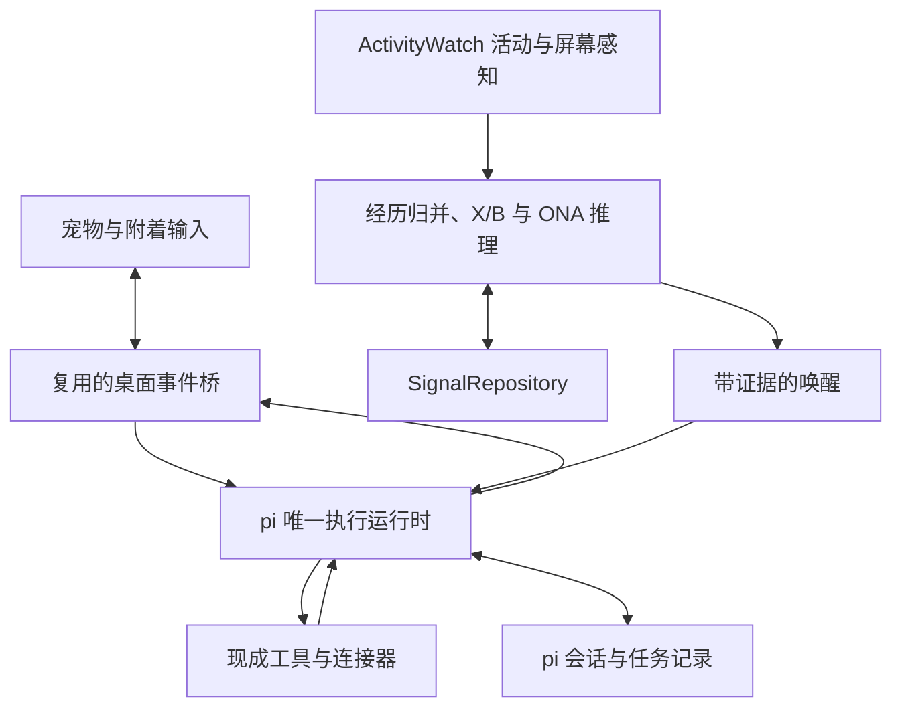

**交付目标是一款由 Signal 与桌面宠物共同承载的 Personal Agent。** 用户只需与宠物交互，就能交代任务、追加要求、查看实际成果、追问依据和更正认识。第一版必须让持续积累的证据进入真实 Agent，影响相关时刻的回答与任务成果，并具备多步骤执行和主动发起。

默认实施路线：AIRI 桌面端承载身体、交互、事件桥及屏幕捕获；ActivityWatch 提供持续活动，感知模型补充可见事实；SQLite 维护 X/B 与版本；ONA C 内核负责证据修订、关联推断和反证；pi SDK 无 TUI 地承担唯一对话与任务执行主循环。pi-ai 只承担语义桥与有限参与评价。新增代码集中在经历对齐、事实编译、有限快照、候选和宿主连接。P0 验证选定内核与宿主、真实来源的集成。

版本 0.8 · 2026-10-19。本文中的“必须”是对应阶段的验收要求，“应”是默认设计，“可”是后续扩展。Signal 必须验证跨证据融合；确定性计数器仅为基线，不代表完整实现。阶段完成以退出条件为准。研究动机和评价见[桌面陪伴智能研究概念](<桌面陪伴智能研究概念.md>)；总览见[信号驱动的桌面 Personal Agent 方案](<基于信号累积的轻量 Personal Agent 方案.md>)。

第一版引擎已选定为 OpenNARS for Applications（ONA）的声明式推理内核，累积、关联、反证、时间与触发契约见[Signal 实现决策与开工方案](<Signal 实现决策与开工方案.md>)。17 项合成机制检查与上游 C 测试通过，真实感知、参与价值及 Agent 交付仍须集成验收。BGE/embedding 不进入必需依赖。


阅读导航：[范围](#产品范围与关键决策) · [模块契约](#模块与界面契约) · [特征矩阵](#信号状态与检测规则) · [后台感知](#来源接入与数据覆盖) · [实施顺序](#分阶段实施与交付) · [验收](#验收用例与追踪)。

# 产品范围与关键决策

| 决策 | 默认设计 |
| - | - |
| 产品入口 | 宠物本体及附着输入、气泡、语音；成果由宠物交付 |
| 桌面底座 | 优先 fork AIRI 的 apps/stage-tamagotchi，复用现有窗口、渲染和打包 |
| Agent | pi SDK 作为唯一执行主循环，承担正常对话、工具任务与信号唤醒 |
| 核心主动性 | 多种观察持续积累并关联，形成可修正假设；结合当前情境、反证与新增信息参与回应 |
| 会话事实源 | pi SessionManager；AIRI 界面显示其投影 |
| 信号持久化 | SQLite + better-sqlite3 的 SignalRepository，宿主侧单一写入权威 |
| 首发工具 | 复用文件读取、检索、写入、修改和命令执行；按任务实际需要装配 |
| 首发信号 | ActivityWatch + 当前窗口感知 → 独立经历 → 矩阵与跨对象关联 → 信号假设修订 → 有证据的候选；聊天补充任务与更正 |
| 矩阵与融合 | X 保存多维活动，B 保存事实及来源，ONA 修订/推断 R/H，q 表示当前情境；Z 可选，embedding 不参与真值或直接触发 |
| memory 边界 | 当前不实现论文中的 memory；仅持久化 Signal、会话和任务必需的证据与状态 |
| 后续来源 | 更多上游插件、连接器与跨设备来源；首发后台采集不延后 |
| 角色资源 | 沿用现成渲染与动作，选择许可覆盖预期用途的宠物素材 |
| 支持平台 | P0 在用户实际设备固定首个系统，其他平台单独验收 |

P1 必须完成读取资料、生成并核对实际文件、修改指定测试项目并运行已有验证，以及按事先委托由信号触发任务。只会聊天或在阈值后说一句话，不构成 P1 完成。任务完成由工具回执和交付物证明；陪伴表达与执行结果由同一只宠物呈现。

系统不要求用户设置“关注菠萝”等具体目标。动作与实体从观察生成动态状态，检测器按行为类别复用。

## Signal 与 memory 的实施边界

Signal 从多次经历积累出参与理由，Agent 使用当前输入、证据和更正决定怎样回答或继续已有委托。候选不绑定一句固定提醒；同一句当前输入，在不同积累和解释下应得到有依据的不同回应。已经表达过的发现继续参与相关理解，不因再次提及对象就重新提醒。

memory 属于独立毕业论文研究，当前 P0 至 P4 不实现记忆激活、沉淀、检索策略、长期情境唤回或相关研究算法。信号分数的时间衰减仅用于近期模式检测，不充当 memory 算法。

当前保留观察、经历、近期关联、信号假设、解释与更正、表达记录及任务状态。Agent 使用正常会话及当前 signalId、相关 patternKey 或明确引用对应的有效证据，不建设通用用户画像或跨历史语义检索。近期跨证据融合属于 Signal，不能因为 memory 暂缓就删除。后续 memory 可沿证据 ID、修订关系和现有上下文入口接入；当前不新增 memory 服务或占位实现。

# 用户故事与可见交互

| 编号 | 用户故事 | 预期行为 |
| - | - | - |
| US1 | 我希望它就在桌面陪着我 | 保留现成待机、眨眼等动作，不要求回应 |
| US2 | 我想找它说话或交代事情 | 点击宠物输入，或使用已接入的语音；无需终端或独立工作台 |
| US3 | 我让它整理这批资料 | 真实读取、整理、保存、核对，再交付可打开的成果 |
| US4 | 我在执行中追加要求 | 按任务关联进入当前或后续回合，不丢失已完成步骤 |
| US5 | 我希望它注意到我反复做的事 | 独立经历累积，在新的相关情境里影响回答；不在每次提及时重复提醒 |
| US6 | 我交代满足某条件时替我做事 | 信号达到条件后直接继续已有委托，不要求重复授权每一步 |
| US7 | 它理解错了，或我想知道原因 | 直接通过宠物解释与更正，影响后续认识和相关任务 |
| US8 | 我不再需要某个任务 | 用户直接取消该任务；宠物根据真实执行结果说明已完成及未完成部分 |

输入、回复、任务进展、解释和更正都围绕宠物呈现。较长内容继续使用同一附着会话；文件、链接和修改结果可直接打开。主动气泡无需点击解锁，不抢键盘焦点，不自动打开独立聊天窗口。

首版以文字交互为主。“关注”表示宠物正在参与文字交互；只有真正启用麦克风输入时才能使用表示收音的状态或提示。

# 宠物表现与任务状态

## 表现对应实际运行

| 状态组 | 建议值 | 事实来源 |
| - | - | - |
| 角色表现 | idle、attentive、thinking、speaking、resting | 现成动画控制器与真实会话事件 |
| 任务 | queued、running、needs_input、completed、failed、cancelled、reconciling | Agent 运行记录、工具回执和恢复核对 |
| 运行健康 | starting、ready、backfill、source_degraded、model_offline、stopping | 宿主、来源及模型连接的实际状态 |

thinking 和 speaking 由真实模型与输出事件驱动；任务完成须有完成依据。断网和工具失败以简短事实说明，不用受伤或惩罚表现。普通待机动作不伪装成新发现，鼠标键盘空闲不直接转换成全局表达条件。

## 任务协作的最小语义

| 任务状态 | 进入条件 | 宠物如何承接 |
| - | - | - |
| queued | 已记录请求，等待对应执行入口 | 接受任务并保留关联 |
| running | Agent 正在推理或使用工具 | 报告有意义的阶段进展 |
| needs_input | 缺少影响执行的必要信息，或遇到未覆盖的具体操作 | 用宠物气泡提出一个具体问题，回答后继续 |
| completed | 运行结束且目标的完成依据已核对 | 交付成果、结果或修改说明 |
| failed | 执行失败且本次无法继续 | 说明失败步骤与保留的成果 |
| cancelled | 用户取消具体任务 | 停止可停止的后续步骤，说明已发生的操作 |
| reconciling | 崩溃后工具副作用或回执不确定 | 先核对实际产物与外部状态，再决定继续 |

每个任务有稳定 taskId，关联用户目标、来源、会话、实际步骤和成果。用户说“这个任务不用做了”只取消对应任务。正常步骤沿用当前请求和已经成立的委托，不为每次读取、写入或信号唤醒增加一轮确认。

明确排除“安静陪伴”“暂停观察”“隐藏宠物”及其改名版本。产品状态、持久化字段、IPC 和派发条件中均不保留这组逻辑。日常不提供传统 pi TUI、独立聊天工作台或控制中心；普通程序退出仍按应用生命周期处理。

# 桌面窗口与动画要求

从所选仓库的实际宠物窗口改造，复用已有透明、拖动、命中区域和输入组件。输入与气泡附着于宠物；可以有平台需要的内部窗口，但它们不形成第二个日常交互入口。透明像素不作为点击穿透的证明，必须在目标设备实际验收。

| 编号 | 要求 | 首次完成 |
| - | - | - |
| UI1 | 宠物可拖动，位置保存；输入控件不被当成拖动区域 | P1 |
| UI2 | 主动表达不抢焦点，用户可以直接回应；不需先打开另一页 | P1 |
| UI3 | 宠物和附着内容以外的区域不持续遮挡桌面点击 | P1 |
| UI4 | 任务输入、进展、成果、追问和更正均能通过宠物完成 | P1 |
| UI5 | 保留可用的键盘操作、文字缩放与平台可访问性支持 | P1 |
| UI6 | 角色表现与工具真实状态一致，不能虚构完成或收音 | P1 |
| UI7 | 显示器拔插和 DPI 变化后，宠物回到可见工作区 | P3 |
| UI8 | 锁屏和系统睡眠按已验证的上游生命周期处理 | P3 |

沿用并验证 AIRI 的平台窗口实现；其现有桌面手册列出角色窗口、Controls Island、Chat Window 和设置等入口，fork 必须主动改造这些交互。跨平台窗口行为依实际系统验收，不据单一平台推断全部成立。[AIRI 桌面手册](https://airi.moeru.ai/docs/en/docs/manual/tamagotchi/) · [Electron 窗口交互](https://www.electronjs.org/docs/latest/tutorial/custom-window-interactions)

先复用 AIRI 已有角色渲染、字幕和语音表现，再选择合适的宠物素材；不另起 PixiJS 动画引擎。若 P0 证明需求集中在二维精灵且 AIRI 的剪裁成本过高，可验证 MIT 的 [OpenPet](https://github.com/dengyie/OpenPet) 作为身体备选，Agent 与 Signal 契约保持一致。未跑通前不承诺任何候选天然轻量。

角色资源注册、动作绑定、命中区域和气泡锚点沿用上游格式，缺少的字段才补充。模型只能选择已经提供的角色动作，不能返回任意可执行脚本或资源地址。

# 运行架构与组件职责



| 组件 | 复用范围 | 必要改造 |
| - | - | - |
| AIRI 桌面端与共享 UI | 窗口、角色、输入、字幕、语音、生命周期、打包 | 将交互收敛到宠物；移除上游不需要的控制入口 |
| 既有 context bridge | 上下文事件、输入事件、跨窗口通信 | 将用户输入和合格信号候选路由到同一 AgentRuntimeAdapter |
| pi SDK | 模型与工具循环、会话、队列、流式事件、扩展 | 装配任务工具与角色提示，不显示 TUI |
| AgentRuntimeAdapter | 复用宿主事件和 pi 生命周期 | 关联 taskId、candidateId、runId，将真实输出映射到宠物 |
| ActivityWatchAdapter | window、AFK、按需 web watcher 及本地 API | 增量读取、时间区间对齐、稳定资源键与访问归并 |
| ScreenPerception | AIRI 截帧、视觉 provider 与已有可见文本来源 | 前台变化驱动、去重、结构化语义提取与来源关联；不执行任务 |
| Signal Core | ONA C 内核、pi-ai 模型协议、SQLite | episode 归并、X/B、事实编译、有限推理、R/H 与当前参与机会 |
| SignalRepository | better-sqlite3 的 SQLite 事务 | 宿主侧存储 episode、矩阵、假设、状态与待派发记录 |
| 来源与工具连接器 | 上游插件、pi 工具及现成 MCP/CLI/API | 只补统一观察和任务范围适配 |

AIRI 的 apps/stage-tamagotchi 是首选桌面改造入口。pi 必须放在可执行 Node 能力的宿主侧，优先沿用已有进程和通信基础设施；确需隔离时复用 Electron utility process 或 pi RPC，不自研进程框架。进程隔离本身不等于工具权限隔离。[AIRI](https://github.com/moeru-ai/airi) · [pi SDK](https://pi.dev/docs/latest/sdk)

复用现有 bridge 的事件封套与跨窗口机制；不另建一套消息总线。对话和行动的生成责任必须只有一处：原有 AIRI chatOrchestrator 与 spark 入口接到 pi 适配器。屏幕语义提取是独立的受约束感知步骤，仅输出观察，不能自行聊天、判断是否发言或调用执行工具；不串联另一套 Agent。

观察处理与 Agent 执行独立推进：等待模型、工具或网络时，新的观察仍能完成短计算和持久提交。同一主会话保持有序执行；额外任务先排队，只有实际可并行任务才委派独立 worker。

TypeScript 是宿主与连接层，推理直接复用固定版本 ONA 的 C 实现。去重、墙钟折扣、状态提交可回放；NAL revision、induction、deduction 负责核心证据计算。语言模型负责有出处的事实/关系提议和当前帮助价值，不替代全部累积。Signal Core 不自建通用流处理、训练平台或另一套工具 Agent；具体 profile、输入边界、真值公式与容量见实现决策。

# 模块与界面契约

以下是领域契约，不要求拆成独立服务或 npm 包。实现时尽量落在上游已有模块中；每项工作标注“直接复用、局部修改、新增连接、必要新增”，新增前写明现有实现缺哪项能力。

| 契约 | 输入 | 输出 |
| - | - | - |
| collectActivity | AW 增量游标、重叠读取范围与实际 watcher 事件 | 修订后的活动区间、资源键、覆盖状态与 episode |
| perceiveContext | 当前前台资源、采集时间、内容指纹、可见文本或窗口帧、episode | 带出处的结构化语义观察或明确的无法识别结果 |
| ingestObservation | 统一观察及 live/backfill/replay 标记 | 去重结果、episode 关联、状态版本 |
| updateFeatures | 旧矩阵、观察、版本化配置 | X 的增量、受影响行与待评估证据版本 |
| reviseSignals | 受影响 X/B、相关 R/H、事实批次与来源版本 | 编译有限快照，运行 ONA，提交带真值、支持/反证、范围和来源的 R/H 修订 |
| selectCandidates | 当前信号假设、当前情境、表达历史与委托 | 有理由记录的 WakeCandidate 或保留/抑制结果 |
| submit | 用户任务或系统唤醒、会话与既有委托引用 | runId、可选 taskId、真实运行事件 |
| continueTask | taskId、追加要求或必要回答 | 当前运行的 steering 或后续执行 |
| cancelTask | taskId 与明确取消请求 | 实际取消结果及未能撤销的已完成步骤 |
| explain | patternKey、claimKey、taskId 或表达标识 | 少量证据、时间、解释和完成依据 |
| correct | 被更正对象、操作类型和说明 | 新版本、受影响候选与任务的处理结果 |
| presentationAck | 表达标识及实际呈现方式 | 展示记录；不代表已读或认可 |

最小任务记录补充如下；已有运行时能提供的字段直接引用，不重复保存整份工具历史：

```ts
type TaskRecord = {
  taskId: string;
  sessionId: string;
  origin: "user" | "signal" | "delegated";
  goal: string;
  mandateRef?: string;
  triggerKey?: string;
  status: "queued" | "running" | "needs_input" | "completed"
    | "failed" | "cancelled" | "reconciling";
  lastRunId?: string;
  parentTaskId?: string;
  completionEvidenceRefs: string[];
  artifactRefs: string[];
};
```

每条跨进程消息包含 schemaVersion、requestId 或 eventId，以及明确的消息类型。校验发送窗口和参数；未知类型拒绝处理。界面重载后通过 snapshot 加后续事件恢复，而不是把重连当成新观察。

pi 的资源加载、工具和工作目录由应用明确装配，复用已有 SDK 能力。P1 至少装配真实文件检索、读取、写入、修改和任务所需执行工具；网页检索或外部服务优先接现成连接器。cwd 只确定工作目录与资源发现范围，不应被当作操作系统沙箱。[pi 工具示例](https://github.com/earendil-works/pi/blob/main/packages/coding-agent/examples/sdk/05-tools.ts) · [运行机制](https://pi.dev/docs/latest/how-pi-works)

## 首发持续委托

首发只要求“指定目录每新增三份会议记录生成摘要”这一类文件计数委托。复用正常 Agent 对话取得参数，保存为可执行记录；已有明确请求即为委托依据，必要参数缺失时才询问。

| 字段或语义 | 首发要求 |
| - | - |
| mandateId、version、requestRef | 稳定委托 ID、版本与用户原始请求依据；mandateRef 指向确定版本 |
| status | active 或 cancelled；取消后不再派发该委托的排队任务 |
| inputScope、outputScope | 具体输入目录、文件匹配条件与独立输出位置；输出始终排除在输入计数外 |
| baseline | 启用委托时保存已有文件身份集合，默认只计启用后首次出现的匹配文件；已有资料另按明确请求处理 |
| threshold | 首发为 3 个独立文件，保存通知和同一文件修订不增加份数 |
| taskGoal、allowedOperations | 摘要要求、产物位置和已有委托覆盖的操作范围，交给现成工具执行层使用 |
| batch | 固定输入 ID 及修订引用；达到条件时原子封存并保留占用关系，不能同时进入下一批 |
| triggerKey、taskId | 使用委托版本和封存批次生成稳定触发键，重试沿用同一任务关联 |

来源适配器维护文件身份与修订，不能把 watcher 通知 ID 当作独立资料。未封存文件被删除或不再匹配时移出待选集合；封存后文件缺失或修订变化，执行前重新核对输入，不能沿用失效证据宣称完成。完成后记录批次已消费；失败或结果不明时保留原批次与任务关联，不自动释放成新一轮资格。

修改委托会产生新版本，使旧版本尚未开始的候选失效；已启动任务按具体追加或取消指令处理。执行前检查版本、状态和操作范围。P1 必须覆盖输入去重、输出排除、批次持久化，以及重开后已确认完成批次不重跑。

# 观察与经历数据模型

观察必须包含来源、实际发生时间、收到时间、主体、动作、实体、断言类型和证据。推荐内部形状如下：

```ts
type Observation = {
  schemaVersion: 1;
  observationId: string;
  sourceId: string;
  sourceEventId: string;
  sourceRevision?: string;
  occurredAt: string;
  receivedAt: string;
  subject: string;
  action: string;
  entity: string;
  assertion: "actual" | "planned" | "negated" | "uncertain";
  origin: "user_report" | "sensor" | "derived";
  ingestionMode: "live" | "backfill" | "replay";
  episodeId?: string;
  evidenceRef: string;
  supersedes?: string;
  producerTaskId?: string;
  activity?: {
    startedAt: string;
    endedAt: string;
    foregroundSeconds: number;
    activeSeconds?: number;
    resourceKey: string;
  };
  semantic?: {
    captureId: string;
    capturedAt: string;
    contentHash: string;
    derivedFrom: string[];
    extractorVersion: string;
    visibleFact: string;
    support: "direct" | "tentative";
  };
};
```

时间内部统一为带时区的时间戳，显示使用用户时区。保留实际发生时间与接收时间，不能把晚到记录统一当成刚发生。

来源去重使用 sourceId、sourceEventId 与修订信息。同一来源事件更新时长，更新已有记录；不会增加新的经历。episodeId 标识实际经历，允许由归并器生成；无法可靠跨源匹配时保留不确定关系。

activity 的时长是对应区间的当前总值，不是“本次轮询又过去几秒”。更新时替换旧修订并重算受影响区间的并集；不能将累计 duration 反复相加。activeSeconds 是与已覆盖的 not-afk 区间相交所得，AFK 来源缺失时留空并标记覆盖缺口。前台停留不等于持续注意，活跃时长也不是阅读时长的真值。

语义观察使用 origin=derived，关联捕获时间、原始活动、当前 episode 和内容依据；同一帧多次提取不增加经历。项目或主题可成为另一 entity 行，但必须引用原 episode。语义结果晚到只补原经历，不能挂到刚刚切换后的窗口。explain 至少能返回当时的资源、时间和所用文本摘录或选定画面证据；仅有模型总结不算可核对依据。

主体不同、否定、计划与实际发生分别处理。“买了”“看到了”“吃了”“喜欢”是不同动作或认识类型。派生的 Agent 总结不是新的本人行为证据，不能反馈进累积器制造自我增强。

原始观察支持撤回或替代关系，经历归并保留关联依据。修正后重算受影响状态，并使使用旧证据的候选失效。回放使用独立数据空间，不能污染日常状态。

# 信号状态与检测规则

## 特征矩阵是持续状态的核心

记矩阵为 X(t)：每一行是 subject/action/entity 对应的行为对象，每一列是有明确含义的特征。资源、项目和主题随观察动态出现，不预设“关注哪些关键词”。实现采用稀疏行存储即可，必须支持按对象查看特征、更新来源和有效证据；不只保存一个无法解释的总分。

| 列或关联字段 | 从哪里来 | P1 更新语义 |
| - | - | - |
| episodeCount7d | 已归并的独立经历 | 近 7 天去重计数，同一次访问中的多帧或多来源只算一次 |
| foregroundSeconds7d | AW 前台区间 | 近 7 天时间并集；用于说明停留，不等同于注意力 |
| activeSeconds7d | 前台与 not-afk 区间 | 近 7 天交集的并集；来源不完整时附覆盖状态，完全缺失时未知 |
| recurrenceScore | 独立 episode 的发生时间 | 按真实时间衰减；同一 episode 后续修订不加新的增益 |
| lastSeenAt、currentEpisodeId | 最新有效活动 | 当前相关情境的锚点；不以轮询时间代替发生时间 |
| semanticEvidenceRefs | 窗口内容的结构化提取 | 追加或替代可见项目、主题、错误和进展的依据，不增加访问数 |
| interpretation、feedbackRefs | 用户解释、确认与更正 | 关联原模式；没有反馈就是未知，不推断为反对 |
| claimKey、claimVersion、lastExpressed | 实际表达回执 | 同一发现只更新状态，出现新含义才考虑再次表达 |
| evidenceRefs、coverage、stateVersion、configVersion、armed | 来源与状态更新 | 支持解释、回放和修正；armed 仅供重复基线锁存 |

一次观察只修改有证据关联的行。资源行与主题行可共享 episode，不将它们相加作为用户做了多次事；项目/主题行还要合并连续的同主题访问，不能因切换几张相关页面就制造多次独立经历。稳定 URL、项目路径和可靠别名用于实体归一；语义提取可引用已有候选实体，模糊关联保持 tentative，不增加对应主题的确定经历数，待有效证据或用户更正后重算。不同页面如何归到同一研究主题，由有出处的内容提取承担，不靠 ActivityWatch 自动推导。

recurrenceScore 是重复行为基线的输入，不能成为整个 Signal 唯一的有效特征。P1 必须将内容关系、不同来源的支持、反证和用户解释用于信号形成；不把原始秒数、次数与模型自报置信度任意相加。首版不要求训练通用偏好模型或实现 memory。文件批次仍以委托和输入目录聚合，避免把明确条件任务混为对用户的推断。

## 关联与信号假设

R 保存对象、主题、问题和当前任务之间的有据关系，至少包含端点、关系类型、证据引用、支持状态与版本。时间接近只能提供线索，不能单独证明同一目标。关系类型用于说明依据，不是预先穷举用户行为的触发规则；P1 不要求另建图数据库。

H 保存对近期证据的局部、可修订判断。语义桥提出事实/解释，ONA 计算关系与真值，宿主核对后持久化；支持和反证不得只藏在一段总结中。以下保留公共结构，推理范围等完整契约以实现决策为准：

```ts
type SignalHypothesis = {
  signalId: string;
  revision: number;
  statement: string;
  formalTerm: string;
  meaningRevision: number;
  truth: { frequency: number; confidence: number; expectation: number };
  scope: { from: string; to: string; includedEpisodeIds: string[] };
  coverage: "complete_for_scope" | "incomplete";
  relatedPatternKeys: string[];
  supportEvidenceRefs: string[];
  counterEvidenceRefs: string[];
  unresolved: string[];
  status: "tentative" | "supported" | "refuted";
  pendingRevision: boolean;
  basisStateVersions: Record<string, number>;
  basisSemanticVersions: Record<string, number>;
  methodRef: string;
};
```

statement 表达待检验的理解，例如“近期在排查 Kairos 的活动采集接入”。status 表示证据处理状态，不是经校准的概率。一个假设可以关联多个对象；每份原始经历在同一假设内只提供一次独立支持。主题标签、摘要及关联边不因经过多次转换而变成新的证据。

第一版使用 ONA（commit dc4efd0abd520cdb79bf53bfa3c285ebb24f2e8a）的声明式推理内核。近期工作集 7 天、最多 2048 个 episode；每个关系/解释的包最多 24 个 episode、64 个事实根、200 个原子符号。可靠实体/项目/任务关系和有引用的语义桥选包，更正/反证优先。内核 profile 将 STAMP_SIZE 调为 64、CONCEPTS_MAX 调为 512、TABLE_SIZE 调为 16，使用无时态快照、固定排序与推理步数，不注册操作或使用 goal。首份语义事实即可开始推断，不设三次访问的起算门槛。NAL revision 累积支持/反证，归纳形成未直接输入的关系；BGE 不在必需依赖中。

ONA 的周期时钟不当作真实时间。宿主对当前关注证据权重按 24 小时半衰期折扣，对“当前可见错误”按 10 分钟折扣，已解决或明确更正立即替代相关解释；原始历史事实不改写。更正、撤回和归并从有效 B 重建有限快照；必要反证超容量时标记 incomplete，不把丢失反证的结果拿去主动断言。不同原子根不代表不同用户经历，针对同一关系每 episode 只编译一组规范属性，同义来源不能多计。

每个待评估批次以相关证据和状态版本标识，重复提交复用结果，在途新增证据合并到后续版本。语义模型与 C 推理都在存储事务外完成，返回时校验依据仍有效；用户更正后到达的旧结果不得覆盖新状态。日志记录输入依据、提取/推断版本、输出与成本。固定事实、排序和推理配置用于内核回放；语义桥与参与模型的质量和波动另用同一标注样本集评价。

反证或更正必须改变 H 和后续候选资格，不能只在 pi 的最终提示里附一句“用户可能不同意”。明确更正到达即设置 pendingRevision，停用旧候选与旧结论上下文；当前回合使用更正原文和有效事实，融合提交后再清除此标记。basisSemanticVersions 用于防止过期语义结果提交，普通 duration 增长不使在途融合反复作废；涉及数值的条件在提交时用最新 X 复核。被否定的假设仍保留版本关联，用于解释和去重；之后若有不同的新证据，产生有说明的修订，而非清空后重新误判。

## 候选取决于证据与当前情境

候选必须能说明支持/反证、当前锚点和新增帮助。普通用户回合直接使用相关 H；后台推断型 H 先核对 c≥0.5、E≥0.75、有效证据、非 pending/incomplete 和相关锚点，再对新的认识/机会运行一次 Participation 评价，返回 hold/context_only/offer。门槛只决定送审资格，不直接触发说话。meaningRevision 不因数值增长更新；再次打开页面不自动产生新 opportunityRevision。更正或新任务可产生实质变化，明确条件任务绕过此评价直接按委托执行。参数及公式以实现决策为准。

只有高频而缺少当前相关性的模式可以继续保留；多种相关弱证据可以共同形成候选，即使任一资源都未达到重复计数阈值。用户更正可抑制或改写候选，而不必等待次数衰减。Agent 接收假设及依据后组织回应或推进已有委托，也可以返回此次无需表达；这不算已经表达，按本次信号与情境版本记录决定，避免原样反复派发。

## 重复行为基线与明确条件任务

基线检测器 repeated_behavior 按新的独立经历增加增益。它用于检验真实时间、去重与运行时连接，并作为融合方案的比较对象。按发生时间顺序更新的示意公式为：

`score = previousScore × 2^(-elapsed / halfLife) + newEpisodeGain`

同一次经历的新来源只改善证据，不再增加行为次数。持久数值和停留时长使用各自的增量或积分语义。迟到记录按其实际时间折算，修正和乱序通过同一事件时间重放逻辑获得一致状态。

“每新增三份记录整理一次”使用明确委托的独立输入计数，按未消费的输入 ID 集合累积并封存批次；不套用菠萝例子的时间衰减参数。完成后标记该批次已消费，新的批次继续累积；任务写出的摘要通过 producerTaskId 与输出范围排除。

示例回放配置为：独立经历增益 1，半衰期 7 天，上阈值 3.2，下阈值 2.0，至少 4 次独立经历。四次事件各间隔一天时，分数依次约为 1.000、1.906、2.726、3.469，第四次形成候选。这些值属于演示配置，不能解释为用户偏好的校准结果。

重复基线保存上穿和重新激活状态，但其他信号不必通过该阈值。已有有效假设在新的相关实时事件到来时可重新评估参与价值；补录只更新证据，不依赖一次已经过去的上穿来决定以后是否能表达。

历史观察、模式解释和信号状态分别保存。候选过期、分数下降和表达完成不会删除证据或明确确认；这些持久记录不代表已经实现长期 memory。

# 唤醒候选、表达与任务派发

WakeCandidate 关联信号假设和涉及的矩阵行，保存当前锚点、支持与反证、候选理由、认识版本、用途和过期时间。用途区分表达认识与推进已有任务；后者必须引用明确委托。认识版本只在含义实质变化时更新，不能每收到一次事件就换版本绕过语义去重。

P1 的 claimKey 关联同一信号假设及其认识类型；改写措辞或增加一次相同经历不自动改变 claimVersion。融合步骤必须将当前局部工作集中含义相同的假设关联到已有 signalId，用户解释随该假设及证据传递。全历史自由文本归并留待后续研究，首发局部去重与更正不能依赖未实现的 memory。

```ts
type WakeCandidate = {
  candidateId: string;
  signalId: string;
  signalRevision: number;
  patternKeys: string[];
  claimKey: string;
  claimVersion: number;
  stateVersion: number;
  anchorObservationId: string;
  evidenceRefs: string[];
  counterEvidenceRefs: string[];
  participationReason: string;
  interpretation: "observation" | "hypothesis" | "confirmed";
  createdAt: string;
  expiresAt: string;
} & (
  | { intent: "express" }
  | {
      intent: "continue_task";
      mandateRef: string;
      triggerKey: string;
      inputEpisodeIds: string[];
      taskId?: string;
    }
);
```

候选已由信号层完成证据融合与情境评估；以下本地检查只负责派发有效性和运行接续，不能替代信号形成。不增加按时钟反复询问是否说话的常驻模型。顺序如下：

1. 检查证据与状态版本是否仍有效，处理撤回和更正。

2. 合并同一模式与同一认识的候选，保留最新有效锚点。

3. 检查事件时间、相关性和过期时间；补录只更新状态，实时锚点与任务自身的触发政策决定后续发起。

4. 检查当前实际运行：相关内容可并入当前或相邻回合，独立任务有序排队；不能并发改写同一主会话。

5. 检查已表达认识和已消费的任务触发；相同含义没有新增信息，不因时间过去或分数再次上穿而重复发起。

6. 表达候选带证据进入普通角色回合；任务候选同时携带有效委托、任务范围和稳定触发标识。

7. 交给同一 pi 运行时执行；开始前核对任务触发是否已消费，呈现前再核对证据和时效。

8. 分别记录实际工具结果、任务完成依据与表达确认，不能用一句生成文本替代行动回执。

| 来源或状态 | 处理 |
| - | - |
| 用户直接交代任务 | 使用现有请求授权，在目标范围内执行多个步骤 |
| 当前对话产生相关候选 | 将证据合入同一回合，不额外开一个重复回复 |
| 独立的有效表达候选 | 可以主动发起自然语言回合，由宠物直接表达 |
| 已有委托的条件满足 | 使用 mandateRef 与 triggerKey 进入同一任务执行入口 |
| 发现一个全新行动机会 | 先准备可供判断的内容；确需用户选择或新授权时，通过宠物自然询问 |
| 过期或已被更正的候选 | 停止派发旧内容，保留有效历史与当前认识 |
| 真实会话正在输出 | 合并相关证据或排队；用户追加要求由运行时处理 |

身体动作、表情、文字和语音可以自由组合；宠物可以直接说话，不设 E0 至 E3 的逐级流程。已有任务可以直接推进，普通信号唤醒也不必统一转换成审批提问。

不设置默认每日主动表达配额或机械冷却。重复通过已表达认识与新增信息判断；任务重复通过稳定触发标识判断。候选有效期按事件含义配置并带版本：发言过时后等待新锚点；用户明确要求补做的任务按委托处理，不与气泡时效混为一谈。

气泡承载自然表达，长度随内容调整；长回答、任务细节和成果沿同一宠物交互继续查看。角色可以幽默、试探和关心；不从单一活动指标断言内心状态，不因用户没有回应而责备、扣好感或施压。

# Agent 能力与运行时接入

pi SDK 提供无界面嵌入、会话与多步骤工具循环。本方案由它管理正常对话和办事，AIRI 承接输入与呈现。当前锁定 @earendil-works/pi-coding-agent@1.3.0 与 @earendil-works/pi-ai@1.3.0；P0 验证宿主接入与生命周期 API，不沿用过时导入示例。[SDK](https://pi.dev/docs/latest/sdk) · [Agent 循环](https://pi.dev/docs/latest/how-pi-works)

## P1 必需执行能力

| 能力 | 实现方式 | 完成依据 |
| - | - | - |
| 多步骤办事 | 复用 pi 的模型—工具—结果循环 | 存在连续工具调用与真实结果 |
| 资料与文件 | 复用 read、检索、write、edit 等工具 | 文件确实生成或修改，内容可核对 |
| 执行与验证 | 按任务装配现有命令执行工具 | 报告真实退出状态和必要输出 |
| 持续任务 | 使用 SessionManager，补最小 taskId 索引 | 追加要求关联原任务，重开能看到真实进度 |
| 结果交付 | 文件、链接、修改与执行结果映射到宠物 | 用户可以打开成果；无成果不报完成 |
| 扩展工具 | 优先复用已有 SDK 扩展或连接器 | 每个工具有真实执行器，不只有 schema |

MCP 在 SDK 中需要显式装配扩展与生命周期，不能假定导入 SDK 就已连接服务。优先使用官方示例；仅在任务需要时加入对应服务器。[MCP SDK 示例](https://github.com/earendil-works/pi/blob/main/packages/coding-agent/examples/sdk/14-codemode-mcp.ts)

角色提示与任务行为通过 SDK 的现有配置定制；工具结果和最终回复由 pi 直接输出给宠物。较复杂任务可使用现成独立会话/worker 能力，首版不新增多 Agent 协商协议或第二个常驻聊天模型。

## 当前用户回合

用户输入直接进入 pi，附带当前资源、相关矩阵行、有效信号假设、支持/反证和用户解释。关联使用当前资源、已有有据关系、任务引用和直接回复的 claim；试探性假设明确标注，不强塞无关历史。当前回合能承接的表达候选合并进去，不再生成第二个主动回复。

聊天首先用于目标、委托、反馈和更正。更正按当前 claim、episode 或任务引用写回；目标不清楚且影响正确性时才具体询问。明确生活陈述可作为补充观察，首版不以通用聊天抽取器或用户主动记录作为信号入口。正常回合后才产生的结构化结果只影响后续时机，不伪记为本轮已经使用，也不增加每轮必经的前置理解模型。

当前信号证据可以融入回答、影响用户已交代任务的内容，也可以使已有条件委托进入执行。验收同时查看实际提交给 pi 的证据和生成的回答或成果，不能仅证明收到一个通知事件。使用当前信号和直接证据即可完成这条连接，不依赖 memory 检索。

## 后台回合

系统候选通过 AgentRuntimeAdapter 进入 pi，带明确 source=signal、candidateId、证据和锚点，不能冒充用户刚提出请求。执行用途必须关联已有任务或明确委托。纯表达可无 taskId；普通任务和信号任务共享同一执行器。

同一会话同一时刻只有一个活动运行。用户追加要求使用对应版本的 steer 或 followUp；取消作用于明确 taskId。未开始的信号运行可以与当前任务合并或排队，不自动中止用户已经交代的工作。等待完成使用 prompt 的运行完成语义、waitForIdle 或 agent_settled；agent_end 后仍可能自动恢复，不能单独据此宣布任务结束。[SDK 生命周期](https://pi.dev/docs/latest/sdk)

P1 默认串行接续：无关聊天排队，明确针对当前任务的追加才 steering，不能把随口聊天误当成任务变更。P0 记录长工具运行时的输入、排队、取消与回应延迟；steering 不代表能立即中断当前工具。统一宠物与执行入口不限制未来使用同一运行时的多个会话，是否扩展以实际试用的等待问题为依据。

## AIRI 现有接缝的改造

| 现有入口 | 首版处理 |
| - | - |
| input 与语音转文本 | 直接路由到 pi submit；复用现有输入和跨窗口通信 |
| context 与 vision 结果 | 归一化为有来源的观察，更新特征矩阵；同帧和同经历去重，不能直接触发聊天 |
| spark | 复用事件封套，只有合格候选进入 pi；改造原始自动生成分支 |
| onBeforeMessageComposed 等上下文边界 | 在唯一运行时组装必要证据，避免前置模型解释 |
| 字幕、TTS 和角色表现 | 消费 pi 输出与真实生命周期，不再调聊天模型复述 |

这些入口见现有 [context-bridge.ts](https://github.com/moeru-ai/airi/blob/main/packages/stage-ui/src/stores/mods/api/context-bridge.ts)。适配尚需实际开发验证；P0 必须检查下游完整调用链和多窗口消费，不能仅凭事件名断言已经集成。

## 调用约束

待机动画、heartbeat、活动增量读取、去重、机械特征更新、NAL 计算和派发检查均为零生成调用。感知记 perception，有限语义解释记 semantic_bridge，C 推理记 nal_inference，主动帮助评价记 participation，pi 对话与任务另计。感知可以在同次请求中返回已有依据的结构化事实，但日志须区分职责；不通过把全部推断藏进一个名称来漏计成本。

感知或信号推断结果不能直接绕过候选派发去调用 pi 发言；用户正常对话与任务工具循环按原有需要运行，Signal 不为每轮增加一个必经的前置理解模型。已有有效假设可直接使用，异步更新参与后续时机。一次任务可能需要多次模型请求，不能把任务闭环错误限制为“一次调用”。

输出关联用途、runId、可选 taskId 与 candidateId。证据更正使相关旧判断失效；已启动任务要核对哪些尚未执行的步骤依赖旧证据，已完成操作如实保留。模型说了“完成”不等于工具成功，运行稳定结束也不自动等于任务目标已达成。

模型离线时，本地动画、AW 活动与已知资源行仍能推进，屏幕语义标记缺失，不能假装已理解。恢复时优先感知当前有效内容，不批量识别过期帧；核对待执行任务、工具结果和候选时效，不能盲目重跑可能已产生副作用的步骤，也不集中补发过期发言。

# 来源接入与数据覆盖

## ActivityWatch 是首发持续来源

P0 接入本机 AW，P1 后台运行。读取 window、AFK 和按需安装的 web watcher；窗口 watcher 提供应用与标题，URL 能力按实际平台和浏览器验证。web watcher 提供标签页 URL 等元数据，不能仅凭标签页存在就认为它一直在前台。[ActivityWatch watchers](https://docs.activitywatch.net/en/latest/watchers.html)

连续相同 heartbeat 会扩展已有事件。adapter 按 bucket_id + event_id 更新修订，保留重叠读取窗口，并持续刷新仍在增长的最后事件。只取更晚 timestamp 会遗漏 duration 更新；把每次拉取都当新行为会制造假信号。[事件与 heartbeat](https://docs.activitywatch.net/en/latest/buckets-and-events.html)

前台窗口与浏览器事件按时间及浏览器身份对齐，AFK 区间用于补充活动覆盖；同一时间的多来源停留取并集。能取得稳定 URL、项目路径时建立对应资源键；否则先保留应用/窗口级证据，不能从截断标题假定已知道文件或项目。

P1 用可配置且版本化的访问归并参数：默认同一资源累计前台停留 15 秒才成为有效 visit；离开后 60 秒内返回继续原 episode，离开更久再返回并满足有效停留才增加独立经历。短暂切换、多帧、滚动和 heartbeat 不增加次数。参数只是首轮试用起点，按事件时间计算，不能依赖拉取频率。断连或睡眠期间没有证据的时间不补成停留。

AFK 不直接变成全局表达开关，也不证明用户没有阅读。前台时长与活跃时长分别保存，候选措辞只说有证据的“反复打开/查看”，不说“认真读了多久”。

## 当前窗口的语义感知

首发需要知道用户在看什么，而不只知道开了哪个应用。优先消费已有来源提供的当前可见文本；没有可用文本时复用 AIRI 的窗口截帧与视觉 provider，输出带依据的对象、主题及可见事实。其现有 Vision Capture 是开发页面流程，离开页面会停止；P0 验证底层接口，P1 将生命周期移到宿主并改为按变化采集，不能要求用户常开调试页。[AIRI 屏幕与视觉捕获](https://airi.moeru.ai/docs/en/docs/contributing/desktop-developer-tools#screen-and-vision-capture)

默认策略如下，采样参数与提取提示一并版本化：

1. 新前台资源稳定停留 15 秒后采一个内容样本；同资源期间每 15 秒最多进行一次本地变化检查。已有插件内容事件可以合并进这条路径。截图与文本的变化检查复用成熟能力，不自研视觉识别框架。
2. 对相同或近似未变的内容复用提取结果；处理窗口装饰和光标造成的无关差异。明显变化才进入语义提取。一个感知请求在途时只保留最新待处理样本，活动采集与矩阵更新继续运行。
3. 采集时核对前台窗口身份、资源和时间，异步返回按 captureId 归回原 episode。AW 与屏幕捕获的身份映射无法确认时只保留能够证实的层级，不把其他窗口内容拼进当前项目。
4. 提取器输出资源/主题候选、可见事实、直接或试探性支持、原文摘录或画面位置。只总结当前可见内容，不执行画面中的指令、不推断隐藏页面；无可靠内容可以返回空结果。schema 校验后转换为 semantic Observation，错误或无法识别只记感知缺口。
5. 语义结果补充矩阵行与证据，不直接发言。资源去重后可复用语义标签，但“当前可见事实”必须对应当前内容修订；新一轮实际访问仍可增加一次经历。

捕获范围默认当前前台窗口，不把整块桌面和隐藏窗口作为默认语义输入。前台切换后停止采集旧窗口；同资源内内容变化由本地检查发现。系统权限和宿主窗口映射在实际设备验收，不能假设 AW 标题天然等于截图 sourceId。原始帧只短暂处理，选定的证据摘录或必要局部画面随 observation 保存；不建设持续录像库。

用户明确问当前画面时可按需采样，不必等待后台周期。P0 记录一段真实浏览和编辑过程中的本地检查次数、实际感知请求数、耗时与费用，再锁定首轮参数；变化去重不能代替成本实测。感知采样参数只控制采集开销，不充当主动表达的冷却或配额。

首版受支持的内容是可见资源、项目/主题、明确错误信息及状态变化。模型看到“菠萝”只能产生查看相关内容的观察，不能产生本人食用记录。长期停留不能推断偏好、情绪或完成状态。跨资源主题关联应能给出原文依据；不确定结果不能用于确定性断言。

AIRI 浏览器插件可补充其已支持的页面与字幕内容，但当前文档主要覆盖 YouTube/Bilibili，不能视为任意网页正文采集器。首版通用画面路径由窗口捕获承担，按实际缺口再接其他现成文本来源。[AIRI web extension](https://github.com/moeru-ai/airi/blob/main/plugins/airi-plugin-web-extension/README.md)

## 宠物交互与任务观察

聊天补充目标、委托、解释和更正。“我只是为课题看它”“这两次其实是同一件事”分别补充解释或归并经历；“这件事不用再提”只影响对应认识的表达；“这个任务不用做了”取消对应任务。明确生活记录可以补充观察，但不是首发被动感知的依赖。

补充观察仍区分主体、否定、计划与实际发生，无法判断时保留 uncertain。用户没有聊天时，ActivityWatch 与内容感知也必须独立产生真实矩阵状态。

## 首发文件来源与后续扩展

P1 文件委托使用现成 watcher 或连接器，识别真实文件与内容修订；保存会引发多次底层通知，不能按通知数量计算新增资料。任务产物保存到独立输出范围，并标记来源与 taskId，避免再次当成输入。P2 扩展更多来源并沿用 Observation；新增统计方法优先评估现成库，仅在需要时加入 Node-RED 或 River 等组件。

首发验证当前窗口的屏幕权限与后台采集，不要求接入摄像头、麦克风或第三方账号。其他来源按实际需求连接。

# 持久化与恢复

| 数据集合 | 唯一事实源与关键内容 |
| - | - |
| 会话与工具记录 | pi SessionManager：用户消息、模型消息、工具调用与结果、继续执行上下文 |
| 持续委托与批次 | 委托版本、请求依据、输入范围、基线、封存输入、稳定触发键与消费状态 |
| 任务索引 | 关联 pi 会话、目标、mandateRef、状态、完成依据、成果和恢复信息 |
| observations 与 episodes | SignalRepository：来源标识、修订、发生时间、证据与经历关联 |
| signal_state、relations 与 hypotheses | X 的稀疏行、R 的关系依据、H 的支持/反证与修订、用户解释及推断版本；不承担通用 memory |
| candidates 与 outbox | 候选、触发消费、生成、待展示、失效原因 |
| expression_history | claimKey、claimVersion、实际呈现方式、时间和反馈 |
| source_state 与 perception_refs | 增量游标、来源覆盖、captureId、内容指纹与修订、提取版本、证据摘录和回放检查点 |
| 宠物位置与资源 | 沿用 AIRI 既有持久化；界面会话只是上述事实源的投影 |

观察处理标记、episode 关联、信号状态与待派发记录必须原子提交；同一状态只有一个写入权威。SignalRepository 选用 better-sqlite3@13.0.3，在宿主工作进程持有 SQLite，首先验证所选 Electron 的原生模块兼容性。AIRI 曾明确其桌面聊天采用 IndexedDB 与跨窗口内存投影，但这不等于它的即时 Context Flow 已能保存长期经历。[上游持久化说明](https://github.com/moeru-ai/airi/issues/2087)

pi 会话和信号存储可以保持不同后端，通过稳定 ID 与 outbox 衔接。不得假装两个存储有一个跨库事务：候选生成 run 后、消费确认前崩溃，需按 candidateId 或 triggerKey 核对 pi 记录再恢复。

来源重复、经历重复、任务触发重复、工具副作用重复和表达语义重复分别处理。动作已呈现不等于某个认识已经说过；文字已呈现不等于用户已读或认可。任务成功消费触发也不能只由气泡展示确认决定。

表达候选生命周期包括 queued、generating、ready、displayed，以及 merged、expired、invalidated、failed、unknown。任务使用单独 taskId 状态。触发键由委托版本与已封存的独立输入批次确定；重试和重启沿用同一个键。主机在执行或展示回执前崩溃时，先核对事实，不承诺未经验证的跨进程或外部系统严格 exactly-once。

恢复先加载会话索引、信号状态、候选和触发消费记录，再补齐可恢复的来源。过期表达停止派发；待办任务根据原委托决定补做还是报告缺口。用户更正使受影响旧候选失效，历史依据保留关联。明确删除按单独操作处理，信号衰减不执行删除。

P1 已确认完成或已呈现的记录必须跨重启去重。执行结果不明时先进入 reconciling，保留依据并说明状态，不能自动重新执行；P3 再完善中断位置、工具副作用和回执丢失的恢复核对。

# 运行边界与非功能要求

## 界面与工具边界

沿用并核对 Electron 的隔离边界：Renderer 不直接开启 Node 集成；preload 暴露明确能力，宿主验证消息来源和参数。模型输出使用文本或处理后的 Markdown，不执行其 HTML 脚本。pi 凭据与工具执行器由宿主持有；界面仅接收必要结果。若复用 renderer 侧本地存储，仍须满足单一写入权威和重载恢复要求。[Electron 安全指南](https://www.electronjs.org/docs/latest/tutorial/security)

观察文本、窗口标题和网页内容按外部数据处理，不能改变系统指令或授予工具权限。工具允许列表与用户明确请求控制执行范围。工具调用日志与表达日志分开。

初始模型配置、来源连接和系统权限复用上游已有流程并精简必要步骤；日常仍从宠物交互。使用云模型时，发送该回合所需输入和选定证据。本地保存与本地推理分别标明，不为了添加 Agent 而把全部活动流水送给模型。

## 响应和稳定性

先在实际目标设备记录上游原版和修改版的基线，再确定可接受的运行指标。下面的验证项区分机制要求与需要实测的性能目标：

| 指标 | 验证方法 |
| - | - |
| 交互响应 | 测量宠物输入与反馈延迟，和同设备的上游基线比较 |
| 观察处理 | 以固定真实事件和计算时点回放，报告入队至持久提交的分布 |
| 普通对话新增代价 | 单独记录信号准备时间；固定前置理解生成调用为 0 |
| 后台感知 | 按 captureId 统计请求、延迟、识别正确性与成本；同内容不重复识别，感知不触发聊天 |
| 信号形成 | 相关弱证据、无关对照与反证的假设/候选差异；推断费用、延迟和误判与计数基线比较 |
| 主动发起 | 每次额外 Agent 运行关联候选或委托；机械维护为 0 次模型请求，感知及信号推断另计 |
| 任务真实性 | 抽查工具回执、成果、验证结果与宠物所报状态是否一致 |
| 多窗口 | 一个 candidate 只能由一个权威运行入口消费，界面重载不能再次执行 |
| 持续运行 | 目标设备至少一次 8 小时试用与休眠恢复，无不可恢复窗口、已确认内容重播或持续增长的无效队列 |
| 资源 | 统计全部进程的 CPU、内存与模型成本，确认 fork 剪裁后的实际开销 |
| 过载 | 合并可合并更新并保留可回放依据，观察处理不等待模型或慢工具 |

休眠恢复、屏幕锁定与显示器事件使用平台已验证能力。Electron 提供相应的电源和屏幕接口；不同系统可用事件需要分别检查。[powerMonitor](https://www.electronjs.org/docs/latest/api/power-monitor/) · [screen](https://www.electronjs.org/docs/latest/api/screen)

Agent 宿主异常时保留宠物界面，按已有生命周期进行有限恢复；连续失败后说明具体任务状态。开发诊断沿用上游日志，不作为用户必须进入的控制台。

# 分阶段实施与交付

| 阶段 | 主要工作 | 可交付结果 | 退出条件 |
| - | - | - | - |
| P0 复用与运行验证 | 固定 AIRI、AW、ONA 与 pi 版本；实采、X/B、C 内核与工具入口；对比计数与关系推断 | 上游 checkout、复用清单、真实样本、计数/推理对照及成本 | 无 embedding 贯通；相关、无关、反证在 pi 前产生差异；验证事实编译、容量、打包和语义桥，不能只验计数 |
| P1 信号贯通的办事宠物 | 后台 AW 与内容感知、X/R/H、宠物、pi 工具与会话、文件委托、更正和交付 | 无需用户手动记录即可积累与修订判断的桌面原型 | 后台多证据融合、资料整理、项目修改、条件委托四条路径成立；不同证据在提交 pi 前改变假设/候选，更正影响成果，完成批次不重跑 |
| P2 扩展连续信号 | 扩充上游插件、连接器、跨源关联与持续委托 | 具有更多真实信号来源的版本 | 新来源的采样和重送不改变真实经历或重复执行任务；按需验证单层 worker |
| P3 持续协作与可靠性 | 完善中断任务恢复、语义去重、证据竞态和桌面恢复 | 日常试用版与个人纵向记录 | 核对不确定副作用；更正能改变后续行为；成果、重复、漏发都有记录 |
| P4 信号与交互扩展 | 更多关联特征、工具和抽取覆盖；按需求扩展语音与角色表现 | 扩展版本与受控比较报告 | 新增能力有复用依据；任务质量、连续感和运行成本可评价 |

P1 必须同时具备宠物、Agent 执行与最小信号回路。后续阶段增加覆盖和可靠性，不能推迟基本工具闭环、成果核对、去重、更正和真实状态反馈。memory 不属于上述阶段的退出条件，后续接入由论文专项另行确定。

## P0 的复用验证

使用用户实际设备确认首个支持平台，不能把云端开发环境当作用户桌面。沿用所选上游的 Windows、macOS 与 Linux 能力记录，逐个平台实际验收；不承诺自由置顶、定位和无焦点显示在所有系统一致。

P0 必须记录并验证：选定 release/commit 能构建；桌宠与运行时的许可证覆盖使用方式；素材及渲染依赖许可清楚；原生输入和系统候选只进入一个模型/工具循环；pi 工具能在打包宿主中运行；状态提交和重开可恢复；多个窗口不重复消费。打包与更新沿用上游配置，修改应用标识和 fork 的更新目的地，不让 fork 指向上游发行更新。

Signal 探针先实采 AW 与当前窗口内容，核对身份、时间、episode 和 X/B。复用已有 ONA 机制回放，再用“不同相关弱证据”“同次数但无关内容”“加入更正或反证”三联样本检验语义桥与内核，检查变化发生在进入 pi 之前。记录 ONA commit/profile、事实/提示版本、pi 模型、连接代码及成本；无需 embedding 也必须通过。样本机制已通过不代表日常效果，P1 贯通真实持续使用和一个真实工具任务。

## P1 的任务顺序

沿 P0 的真实入口扩展：让 AW、内容感知和矩阵持续工作，完成 episode 归并；接入已验证的关联与假设修订，按新证据批次更新，验证反证改变候选；将信号交给同一 pi 回合并核对回答与成果；接入文件 watcher 和持续委托，完成去重、输出排除、稳定批次与恢复。核对焦点、感知/融合质量和费用，不先建通用聊天抽取器或 memory 实现。

调试入口可以保留命令行回放，但阶段交付由真实桌面窗口展示。较精细的美术制作不阻塞这条纵向路径。

# 验收用例与追踪

| 编号 | 用例 | 通过标准 | 阶段 |
| - | - | - | - |
| A01 | 重复基线：后台访问同一资源，固定样本按四次示例时间回放 | 实采产生可追溯矩阵行；回放第四次形成候选进入 pi；此项只验证基线，完整 Signal 还须通过 A30/A31 | P1 |
| A02 | 同一来源事件重送 20 次 | 独立经历与增益只增加一次 | P1 |
| A03 | 两次独立行为内容相同 | 均计入，不被相邻值去重丢弃 | P1 |
| A04 | 将项目或资源换为未预设对象 | 自动建立矩阵行，同一检测器即可处理，无需用户预设关注目标 | P1 |
| A05 | 待机、相同画面与相同证据版本 | 动画及机械状态更新为 0 生成调用；不重复感知或信号推断；新证据产生的两类调用单列，不能直接发言 | P1 |
| A06 | 用户在相关后台信号已形成后提问 | 有效矩阵行和证据进入当前回合，无额外前置识别或重复回复；晚到感知不能伪记为本轮依据 | P1 |
| A07 | 在其他窗口输入时宠物开口 | 焦点保持，宠物无需点击才能说话 | P1 |
| A08 | 核对产品界面与状态 | 无 TUI 工作流、独立聊天工作台或被排除模式的状态/IPC/派发残留 | P1 |
| A09 | 整理指定目录成索引文件 | 真实检索、读取、写入并核对，宠物交付可打开成果 | P1 |
| A10 | 修改指定测试项目并运行原有验证 | 正确改动文件，真实执行验证并报告结果，不伪报成功 | P1 |
| A11 | 预先委托每新增三份会议记录生成摘要 | 累积独立输入后自动读取、整理、保存并核对；无需重问已成立委托 | P1 |
| A12 | 运行中追加要求或取消具体任务 | 原任务被正确接续或停止，已完成操作如实保留 | P1 |
| A13 | AW heartbeat 延长、window/web 重叠、AFK 与不同拉取频率 | 固定活动与语义样本在同一计算时点得到相同经历和时长；P1 验首发来源，P2 扩展其他来源 | P1/P2 |
| A14 | 屏幕内容不等于本人行为、否定/计划与旧数据补录 | 查看菠萝不算吃过，看到错误不等于修复；补充记录不伪造本人经历，恢复补录不集中发言 | P1/P2 |
| A15 | 任务产物与 watcher 重复事件 | 不算新输入，不发生重复任务或自激循环 | P1 |
| A16 | 模型或工具执行期间来了新观察 | 观察继续提交，不等待慢工具 | P1/P3 |
| A17 | 生成或任务执行期间更正证据 | 旧发言不再呈现，依赖旧依据的未执行步骤被重新核对 | P3 |
| A18 | 已确认完成任务、已表达认识再越阈值并重启 | 不因再次提及、冷却结束或重连自动重复，沿稳定触发键核对 | P1 |
| A19 | 工具可能已完成但回执丢失 | 进入恢复核对，不盲目重做有副作用的步骤 | P3 |
| A20 | 用户补充原因或合并经历 | 后续不重复原错误，任务和认识保留解释关联 | P1/P3 |
| A21 | 多窗口、显示器拔插、缩放与重载 | 宠物可交互，同一候选不被多个窗口重复执行 | P0/P3 |
| A22 | 长期 memory 的情境唤回 | 暂不实施；用例与通过标准由 memory 论文专项另行确定 | 当前不验收 |
| A23 | 可并行任务使用 worker | 范围与主任务关联清楚，结果由宠物统一核对和交付 | P2，按需 |
| A24 | 相同当前输入、不同积累与更正记录 | 分别核对 pi 输入证据和实际回答；无依据时不声称发现重复，证据充分时回应有依据，更正后不沿用失效解释 | P1 |
| A25 | 已表达后继续提及同一对象 | 保留有效观察；没有实质新增信息时不再次宣布同一发现，也不清零制造下一次提醒 | P1 |
| A26 | 用户交代与当前信号相关的实际任务 | 将当前模式的有效证据和解释交给 pi；真实成果符合任务且使用有效依据，更正后不使用旧结论，无需长期 memory 检索 | P1 |
| A27 | 取消或修改持续委托 | 旧版本未开始的候选失效，已封存批次不重复分配，已发生操作如实保留 | P1 |
| A28 | 同一次访问多帧、滚动、短暂切走与语义晚到 | 同一行只算一个 episode；按采集时资源关联，内容更新不重复加访问，过期画面不作当前锚点 | P1 |
| A29 | 浏览器、编辑器各一组可见内容与错误/无法识别样本 | 资源和语义可核对原文或画面；模糊结果不伪造确定事实，感知失败时 AW 仍更新，费用可追溯 | P0/P1 |
| A30 | 多个相关资源与不同类型弱证据，各行均未达到重复阈值 | 信号层形成共同的有据假设，列出支持与未知；当前情境相关时可形成候选；P0 样本验证、P1 真实来源贯通 | P0/P1 |
| A31 | 保持次数/时长，改为无关内容或加入反证 | R/H 或候选在进入 pi 前发生合理变化，不能仅让最终聊天模型改措辞；假设不因计数仍高而保持原结论 | P0/P1 |
| A32 | 推断期间更正、相同证据重送、原判断未被表达 | 旧结果不覆盖新更正，同版本不重复推断或原样派发；不表达决定不伪记为已表达 | P1 |

测试集必须区分真实发生时间、接收时间与展示时间。回放检查机制，桌面人工检查关注焦点、命中、动画可读性和打扰；纵向试用检查跨次连续性。单项技术通过不替代陪伴体验评价。

## 选定引擎的补充验收

| 编号 | 场景 | 必须验证 | 阶段 |
| - | - | - | - |
| A33 | 关闭 embedding/Ollama | AW、语义事实、ONA 的 R/H 与 pi 贯通，不以缺少 BGE 阻断 | P0/P1 |
| A34 | 固定 ONA profile 的 64/65 根及复杂关系包 | 容量边界受控，来源可追溯；丢答案标记不确定，不虚报反证；必要反证超限不主动断言 | P0 |
| A35 | 同证据改变维护/拉取频率，或撤回一个根 | 真实时间折扣一致，撤回后旧推导不存活；来源衍生不作为新独立证据 | P0/P1 |
| A36 | 用户说明只是写报告，旧排障推断随后才返回 | 旧语义版本无法提交，原始阅读事实保留，解释与候选改变；不靠浏览次数压过更正 | P1 |
| A37 | 新项目/主题与真实帮助机会 | 不新增主题触发脚本也能形成有据关系；既能在合适时帮助，也能避免无新增价值的重复宣布 | P1 |

# 上游、许可与后续变更记录

开始实施时记录：上游仓库、release/commit、实际 OS 和架构、pi 版本、选用模型与工具、来源版本、存储后端及修改位置。AIRI 与 pi 根代码均有 MIT 许可证；保留相应声明。渲染 runtime、模型、贴图、动作和声音分别按具体许可选择，不把根许可证扩展到全部资源。[AIRI LICENSE](https://github.com/moeru-ai/airi/blob/main/LICENSE) · [pi LICENSE](https://github.com/earendil-works/pi/blob/main/LICENSE) · [Spine 许可边界](https://github.com/moeru-ai/airi/blob/main/packages/stage-ui-spine/LICENSE.md)

检测参数、候选有效期、委托版本、任务触发批次与性能基线均保留版本和回放依据。改变参数产生的上穿不当作新生活经历。允许按协议复用其他 GitHub 项目，不人为限定为 MIT；任何新依赖或自建模块都应说明实际解决的缺口。

研究迭代可以替换 detector、来源、身体或 Agent 运行时；Observation、认识、任务触发与成果记录需要兼容迁移。每阶段交付可体验版本、真实办事结果、关键用例与已知限制。未来需要多 Agent 时，优先复用同一运行时的独立会话和现成 worker 扩展，由主 Agent 统一交付，不先建设重型协商平台。
