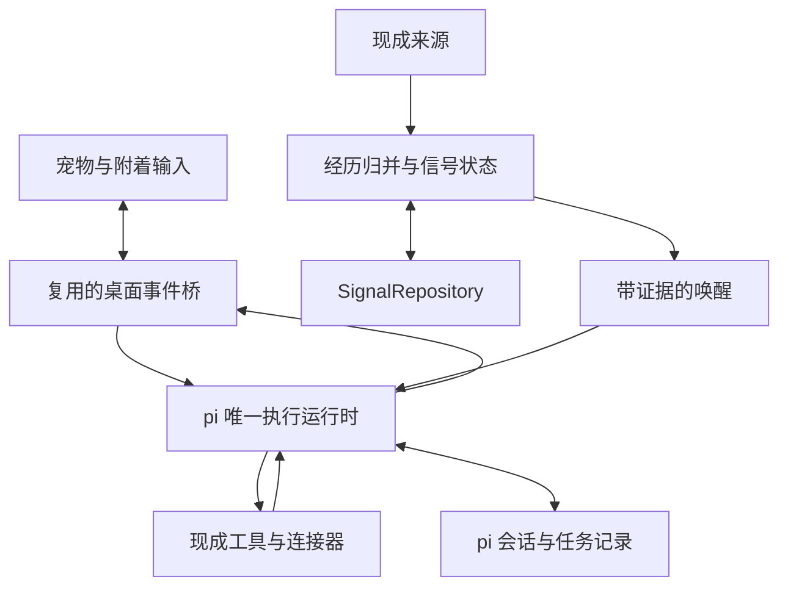

**交付目标是一款由桌面宠物承载的 Personal Agent。** 用户只需与宠物交互，就能交代任务、追加要求、查看实际成果、追问依据和更正认识。第一版必须同时具备真实多步骤执行、持续信号累积和主动发起。

默认实施路线：以 AIRI 的桌面端作为首选 fork 底座，复用身体、输入、字幕、语音与事件桥；以 pi SDK 无 TUI 地承担唯一的对话和任务执行主循环。新增代码集中在信号语义、宿主适配和缺失的任务关联。P0 可以用实测更合适且能力等价的现成组件替换具体选型，不能取消真实 Agent 能力。

版本 0.2 · 2026-10-19。本文中的“必须”是对应阶段的验收要求，“应”是默认设计，“可”是后续扩展。阶段完成以退出条件为准。研究动机和评价见[桌面陪伴智能研究概念](https://chatgpt.com/space/page_69fd36d483a08191af3cdcd820b01f65)；总览见[信号驱动的桌面 Personal Agent 方案](https://chatgpt.com/space/page_652c2c270e2c81918cfaf675828dd257)。

# 产品范围与关键决策

| 决策 | 默认设计 |
| - | - |
| 产品入口 | 宠物本体及附着输入、气泡、语音；成果由宠物交付 |
| 桌面底座 | 优先 fork AIRI 的 apps/stage-tamagotchi，复用现有窗口、渲染和打包 |
| Agent | pi SDK 作为唯一执行主循环，承担正常对话、工具任务与信号唤醒 |
| 核心主动性 | 观察进入持久状态；达到阈值后携带证据发起，不周期性问模型要不要行动 |
| 会话事实源 | pi SessionManager；AIRI 界面显示其投影 |
| 信号持久化 | 独立 SignalRepository，先验证复用现有本地存储，能力不足才新增适配 |
| 首发工具 | 复用文件读取、检索、写入、修改和命令执行；按任务实际需要装配 |
| 首发信号 | 宠物对话中的明确观察、任务委托、现成文件变化事件或固定事件回放 |
| 后续来源 | 上游浏览器插件、现成连接器；ActivityWatch 在覆盖缺口存在时加入 |
| 角色资源 | 沿用现成渲染与动作，选择许可覆盖预期用途的宠物素材 |
| 支持平台 | P0 在用户实际设备固定首个系统，其他平台单独验收 |

P1 必须完成读取资料、生成并核对实际文件、修改指定测试项目并运行已有验证，以及按事先委托由信号触发任务。只会聊天或在阈值后说一句话，不构成 P1 完成。任务完成由工具回执和交付物证明；陪伴表达与执行结果由同一只宠物呈现。

系统不要求用户设置“关注菠萝”等具体目标。动作与实体从观察生成动态状态，检测器按行为类别复用。

# 用户故事与可见交互

| 编号 | 用户故事 | 预期行为 |
| - | - | - |
| US1 | 我希望它就在桌面陪着我 | 保留现成待机、眨眼等动作，不要求回应 |
| US2 | 我想找它说话或交代事情 | 点击宠物输入，或使用已接入的语音；无需终端或独立工作台 |
| US3 | 我让它整理这批资料 | 真实读取、整理、保存、核对，再交付可打开的成果 |
| US4 | 我在执行中追加要求 | 按任务关联进入当前或后续回合，不丢失已完成步骤 |
| US5 | 我希望它注意到我反复做的事 | 独立经历累积，在新的相关情境里主动表达 |
| US6 | 我交代满足某条件时替我做事 | 信号达到条件后直接继续已有委托，不要求重复授权每一步 |
| US7 | 它理解错了，或我想知道原因 | 直接通过宠物解释与更正，影响后续认识和相关任务 |
| US8 | 我不再需要某个任务 | 用户直接取消该任务；宠物根据真实执行结果说明已完成及未完成部分 |

输入、回复、任务进展、解释和更正都围绕宠物呈现。较长内容继续使用同一附着会话；文件、链接和修改结果可直接打开。主动气泡无需点击解锁，不抢键盘焦点，不自动打开独立聊天窗口。

首版以文字交互为主。“关注”表示宠物正在参与文字交互；只有真正启用麦克风输入时才能使用表示收音的状态或提示。

# 宠物表现与任务状态

## 表现对应实际运行

| 状态组 | 建议值 | 事实来源 |
| - | - | - |
| 角色表现 | idle、attentive、thinking、speaking、resting | 现成动画控制器与真实会话事件 |
| 任务 | queued、running、needs_input、completed、failed、cancelled、reconciling | Agent 运行记录、工具回执和恢复核对 |
| 运行健康 | starting、ready、backfill、source_degraded、model_offline、stopping | 宿主、来源及模型连接的实际状态 |

thinking 和 speaking 由真实模型与输出事件驱动；任务完成须有完成依据。断网和工具失败以简短事实说明，不用受伤或惩罚表现。普通待机动作不伪装成新发现，鼠标键盘空闲不直接转换成全局表达条件。

## 任务协作的最小语义

| 任务状态 | 进入条件 | 宠物如何承接 |
| - | - | - |
| queued | 已记录请求，等待对应执行入口 | 接受任务并保留关联 |
| running | Agent 正在推理或使用工具 | 报告有意义的阶段进展 |
| needs_input | 缺少影响执行的必要信息，或遇到未覆盖的具体操作 | 用宠物气泡提出一个具体问题，回答后继续 |
| completed | 运行结束且目标的完成依据已核对 | 交付成果、结果或修改说明 |
| failed | 执行失败且本次无法继续 | 说明失败步骤与保留的成果 |
| cancelled | 用户取消具体任务 | 停止可停止的后续步骤，说明已发生的操作 |
| reconciling | 崩溃后工具副作用或回执不确定 | 先核对实际产物与外部状态，再决定继续 |

每个任务有稳定 taskId，关联用户目标、来源、会话、实际步骤和成果。用户说“这个任务不用做了”只取消对应任务。正常步骤沿用当前请求和已经成立的委托，不为每次读取、写入或信号唤醒增加一轮确认。

明确排除“安静陪伴”“暂停观察”“隐藏宠物”及其改名版本。产品状态、持久化字段、IPC 和派发条件中均不保留这组逻辑。日常不提供传统 pi TUI、独立聊天工作台或控制中心；普通程序退出仍按应用生命周期处理。

# 桌面窗口与动画要求

从所选仓库的实际宠物窗口改造，复用已有透明、拖动、命中区域和输入组件。输入与气泡附着于宠物；可以有平台需要的内部窗口，但它们不形成第二个日常交互入口。透明像素不作为点击穿透的证明，必须在目标设备实际验收。

| 编号 | 要求 | 首次完成 |
| - | - | - |
| UI1 | 宠物可拖动，位置保存；输入控件不被当成拖动区域 | P1 |
| UI2 | 主动表达不抢焦点，用户可以直接回应；不需先打开另一页 | P1 |
| UI3 | 宠物和附着内容以外的区域不持续遮挡桌面点击 | P1 |
| UI4 | 任务输入、进展、成果、追问和更正均能通过宠物完成 | P1 |
| UI5 | 保留可用的键盘操作、文字缩放与平台可访问性支持 | P1 |
| UI6 | 角色表现与工具真实状态一致，不能虚构完成或收音 | P1 |
| UI7 | 显示器拔插和 DPI 变化后，宠物回到可见工作区 | P3 |
| UI8 | 锁屏和系统睡眠按已验证的上游生命周期处理 | P3 |

沿用并验证 AIRI 的平台窗口实现；其现有桌面手册列出角色窗口、Controls Island、Chat Window 和设置等入口，fork 必须主动改造这些交互。跨平台窗口行为依实际系统验收，不据单一平台推断全部成立。[AIRI 桌面手册](https://airi.moeru.ai/docs/en/docs/manual/tamagotchi/) · [Electron 窗口交互](https://www.electronjs.org/docs/latest/tutorial/custom-window-interactions)

先复用 AIRI 已有角色渲染、字幕和语音表现，再选择合适的宠物素材；不另起 PixiJS 动画引擎。若 P0 证明需求集中在二维精灵且 AIRI 的剪裁成本过高，可验证 MIT 的 [OpenPet](https://github.com/dengyie/OpenPet) 作为身体备选，Agent 与 Signal 契约保持一致。未跑通前不承诺任何候选天然轻量。

角色资源注册、动作绑定、命中区域和气泡锚点沿用上游格式，缺少的字段才补充。模型只能选择已经提供的角色动作，不能返回任意可执行脚本或资源地址。

# 运行架构与组件职责



| 组件 | 复用范围 | 必要改造 |
| - | - | - |
| AIRI 桌面端与共享 UI | 窗口、角色、输入、字幕、语音、生命周期、打包 | 将交互收敛到宠物；移除上游不需要的控制入口 |
| 既有 context bridge | 上下文事件、输入事件、跨窗口通信 | 将用户输入和阈值候选路由到同一 AgentRuntimeAdapter |
| pi SDK | 模型与工具循环、会话、队列、流式事件、扩展 | 装配任务工具与角色提示，不显示 TUI |
| AgentRuntimeAdapter | 复用宿主事件和 pi 生命周期 | 关联 taskId、candidateId、runId，将真实输出映射到宠物 |
| Signal Core | 复用现有事件分发与调度能力 | 必要新增 episode 归并、实际时间累积和阈值检测 |
| SignalRepository | 优先扩展既有本地存储后端 | 补独立命名空间、事务、状态与待派发记录 |
| 来源与工具连接器 | 上游插件、pi 工具及现成 MCP/CLI/API | 只补统一观察和任务范围适配 |

AIRI 的 apps/stage-tamagotchi 是首选桌面改造入口。pi 必须放在可执行 Node 能力的宿主侧，优先沿用已有进程和通信基础设施；确需隔离时复用 Electron utility process 或 pi RPC，不自研进程框架。进程隔离本身不等于工具权限隔离。[AIRI](https://github.com/moeru-ai/airi) · [pi SDK](https://pi.dev/docs/latest/sdk)

复用现有 bridge 的事件封套与跨窗口机制；不另建一套消息总线。输入、被动上下文和主动候选的生成责任必须只有一处：原有 AIRI chatOrchestrator 与 spark 入口涉及生成的分支接到 pi 适配器，避免先由 AIRI 模型判断、再交给 pi、最后又调用模型改写。

观察处理与 Agent 执行独立推进：等待模型、工具或网络时，新的观察仍能完成短计算和持久提交。同一主会话保持有序执行；额外任务先排队，只有实际可并行任务才委派独立 worker。

状态转移使用可回放的普通 TypeScript 函数。先复用 AIRI 的事件机制和现有存储；只有明确缺少流操作或持久化能力时才加入 RxJS、SQLite 等库。Signal Core 是领域模块，不建设通用 CEP、调度或 Agent 框架。

# 模块与界面契约

以下是领域契约，不要求拆成独立服务或 npm 包。实现时尽量落在上游已有模块中；每项工作标注“直接复用、局部修改、新增连接、必要新增”，新增前写明现有实现缺哪项能力。

| 契约 | 输入 | 输出 |
| - | - | - |
| ingestObservation | 统一观察及 live/backfill/replay 标记 | 去重结果、episode 关联、状态版本 |
| step | 旧状态、观察、检测配置 | 新状态与可选 WakeCandidate |
| submit | 用户任务或系统唤醒、会话与既有委托引用 | runId、可选 taskId、真实运行事件 |
| continueTask | taskId、追加要求或必要回答 | 当前运行的 steering 或后续执行 |
| cancelTask | taskId 与明确取消请求 | 实际取消结果及未能撤销的已完成步骤 |
| explain | patternKey、claimKey、taskId 或表达标识 | 少量证据、时间、解释和完成依据 |
| correct | 被更正对象、操作类型和说明 | 新版本、受影响候选与任务的处理结果 |
| presentationAck | 表达标识及实际呈现方式 | 展示记录；不代表已读或认可 |

最小任务记录补充如下；已有运行时能提供的字段直接引用，不重复保存整份工具历史：

```ts
type TaskRecord = {
  taskId: string;
  sessionId: string;
  origin: "user" | "signal" | "delegated";
  goal: string;
  mandateRef?: string;
  triggerKey?: string;
  status: "queued" | "running" | "needs_input" | "completed"
    | "failed" | "cancelled" | "reconciling";
  lastRunId?: string;
  parentTaskId?: string;
  completionEvidenceRefs: string[];
  artifactRefs: string[];
};
```

每条跨进程消息包含 schemaVersion、requestId 或 eventId，以及明确的消息类型。校验发送窗口和参数；未知类型拒绝处理。界面重载后通过 snapshot 加后续事件恢复，而不是把重连当成新观察。

pi 的资源加载、工具和工作目录由应用明确装配，复用已有 SDK 能力。P1 至少装配真实文件检索、读取、写入、修改和任务所需执行工具；网页检索或外部服务优先接现成连接器。cwd 只确定工作目录与资源发现范围，不应被当作操作系统沙箱。[pi 工具示例](https://github.com/earendil-works/pi/blob/main/packages/coding-agent/examples/sdk/05-tools.ts) · [运行机制](https://pi.dev/docs/latest/how-pi-works)

# 观察与经历数据模型

观察必须包含来源、实际发生时间、收到时间、主体、动作、实体、断言类型和证据。推荐内部形状如下：

```ts
type Observation = {
  schemaVersion: 1;
  observationId: string;
  sourceId: string;
  sourceEventId: string;
  sourceRevision?: string;
  occurredAt: string;
  receivedAt: string;
  subject: string;
  action: string;
  entity: string;
  assertion: "actual" | "planned" | "negated" | "uncertain";
  origin: "user_report" | "sensor" | "derived";
  ingestionMode: "live" | "backfill" | "replay";
  episodeId?: string;
  evidenceRef: string;
  supersedes?: string;
  producerTaskId?: string;
};
```

时间内部统一为带时区的时间戳，显示使用用户时区。保留实际发生时间与接收时间，不能把晚到记录统一当成刚发生。

来源去重使用 sourceId、sourceEventId 与修订信息。同一来源事件更新时长，更新已有记录；不会增加新的经历。episodeId 标识实际经历，允许由归并器生成；无法可靠跨源匹配时保留不确定关系。

主体不同、否定、计划与实际发生分别处理。“买了”“看到了”“吃了”“喜欢”是不同动作或认识类型。派生的 Agent 总结不是新的本人行为证据，不能反馈进累积器制造自我增强。

原始观察支持撤回或替代关系，经历归并保留关联依据。修正后重算受影响状态，并使使用旧证据的候选失效。回放使用独立数据空间，不能污染日常状态。

# 信号状态与检测规则

状态键默认由 subject、action、entity 组成，实体随观察动态出现。每个键保存特征行：近期累积量、独立经历数、最后更新时间、有效证据引用、armed 标记、配置版本和状态版本。首版可以是稀疏键值结构；需要交叉关联时再增加相关特征，不为“矩阵”一词强建稠密计算系统。 按文件批次办事时，聚合键使用委托和输入目录，文件身份用于独立输入去重；不能为每个文件各建一行后期待它们自动累计成三份。

首发检测器 repeated_behavior 按新的独立经历增加增益。按发生时间顺序更新的示意公式为：

`score = previousScore × 2^(-elapsed / halfLife) + newEpisodeGain`

同一次经历的新来源只改善证据，不再增加行为次数。持久数值和停留时长使用各自的增量或积分语义。迟到记录按其实际时间折算，修正和乱序通过同一事件时间重放逻辑获得一致状态。

“每新增三份记录整理一次”使用明确委托的独立输入计数，按未消费的输入 ID 集合累积并封存批次；不套用菠萝例子的时间衰减参数。完成后标记该批次已消费，新的批次继续累积；任务写出的摘要通过 producerTaskId 与输出范围排除。

示例回放配置为：独立经历增益 1，半衰期 7 天，上阈值 3.2，下阈值 2.0，至少 4 次独立经历。四次事件各间隔一天时，分数依次约为 1.000、1.906、2.726、3.469，第四次形成候选。这些值属于演示配置，不能解释为用户偏好的校准结果。

检测器保存上穿和重新激活状态。已有足够证据但尚未表达的模式，在新的相关实时事件到来时也可以形成候选；旧数据补录仅更新知识，不依赖一次已经过去的上穿来决定以后是否能表达。

历史观察、确认认识、激活状态分别保存。候选过期、分数下降和表达完成不会删除历史或清空偏好。

# 唤醒候选、表达与任务派发

WakeCandidate 保存触发原因、当前锚点、有效证据、认识版本、用途和过期时间。用途区分表达认识与推进已有任务；后者必须引用明确委托。认识版本只在含义实质变化时更新，不能每收到一次事件就换版本绕过语义去重。

```ts
type WakeCandidate = {
  candidateId: string;
  patternKey: string;
  claimKey: string;
  claimVersion: number;
  stateVersion: number;
  anchorObservationId: string;
  evidenceRefs: string[];
  interpretation: "observation" | "hypothesis" | "confirmed";
  createdAt: string;
  expiresAt: string;
} & (
  | { intent: "express" }
  | {
      intent: "continue_task";
      mandateRef: string;
      triggerKey: string;
      inputEpisodeIds: string[];
      taskId?: string;
    }
);
```

本地规则决定候选有效性和运行接续，不增加常驻 LLM 判断器。顺序如下：

1. 检查证据与状态版本是否仍有效，处理撤回和更正。

2. 合并同一模式与同一认识的候选，保留最新有效锚点。

3. 检查事件时间、相关性和过期时间；补录只更新状态，实时锚点与任务自身的触发政策决定后续发起。

4. 检查当前实际运行：相关内容可并入当前或相邻回合，独立任务有序排队；不能并发改写同一主会话。

5. 检查已表达认识和已消费的任务触发；相同含义没有新增信息，不因时间过去或分数再次上穿而重复发起。

6. 表达候选带证据进入普通角色回合；任务候选同时携带有效委托、任务范围和稳定触发标识。

7. 交给同一 pi 运行时执行；开始前核对任务触发是否已消费，呈现前再核对证据和时效。

8. 分别记录实际工具结果、任务完成依据与表达确认，不能用一句生成文本替代行动回执。

| 来源或状态 | 处理 |
| - | - |
| 用户直接交代任务 | 使用现有请求授权，在目标范围内执行多个步骤 |
| 当前对话产生相关候选 | 将证据合入同一回合，不额外开一个重复回复 |
| 独立的有效表达候选 | 可以主动发起自然语言回合，由宠物直接表达 |
| 已有委托的条件满足 | 使用 mandateRef 与 triggerKey 进入同一任务执行入口 |
| 发现一个全新行动机会 | 先准备可供判断的内容；确需用户选择或新授权时，通过宠物自然询问 |
| 过期或已被更正的候选 | 停止派发旧内容，保留有效历史与当前认识 |
| 真实会话正在输出 | 合并相关证据或排队；用户追加要求由运行时处理 |

身体动作、表情、文字和语音可以自由组合；宠物可以直接说话，不设 E0 至 E3 的逐级流程。已有任务可以直接推进，普通信号唤醒也不必统一转换成审批提问。

不设置默认每日主动表达配额或机械冷却。重复通过已表达认识与新增信息判断；任务重复通过稳定触发标识判断。候选有效期按事件含义配置并带版本：发言过时后等待新锚点；用户明确要求补做的任务按委托处理，不与气泡时效混为一谈。

气泡承载自然表达，长度随内容调整；长回答、任务细节和成果沿同一宠物交互继续查看。角色可以幽默、试探和关心；不从单一活动指标断言内心状态，不因用户没有回应而责备、扣好感或施压。

# Agent 能力与运行时接入

pi SDK 提供无界面嵌入、会话与多步骤工具循环。本方案由它管理正常对话和办事，AIRI 承接输入与呈现。当前官方包为 @earendil-works/pi-coding-agent；P0 锁定实际版本及 API，不沿用过时导入示例。[SDK](https://pi.dev/docs/latest/sdk) · [Agent 循环](https://pi.dev/docs/latest/how-pi-works)

## P1 必需执行能力

| 能力 | 实现方式 | 完成依据 |
| - | - | - |
| 多步骤办事 | 复用 pi 的模型—工具—结果循环 | 存在连续工具调用与真实结果 |
| 资料与文件 | 复用 read、检索、write、edit 等工具 | 文件确实生成或修改，内容可核对 |
| 执行与验证 | 按任务装配现有命令执行工具 | 报告真实退出状态和必要输出 |
| 持续任务 | 使用 SessionManager，补最小 taskId 索引 | 追加要求关联原任务，重开能看到真实进度 |
| 结果交付 | 文件、链接、修改与执行结果映射到宠物 | 用户可以打开成果；无成果不报完成 |
| 扩展工具 | 优先复用已有 SDK 扩展或连接器 | 每个工具有真实执行器，不只有 schema |

MCP 在 SDK 中需要显式装配扩展与生命周期，不能假定导入 SDK 就已连接服务。优先使用官方示例；仅在任务需要时加入对应服务器。[MCP SDK 示例](https://github.com/earendil-works/pi/blob/main/packages/coding-agent/examples/sdk/14-codemode-mcp.ts)

角色提示与任务行为通过 SDK 的现有配置定制；工具结果和最终回复由 pi 直接输出给宠物。较复杂任务可使用现成独立会话/worker 能力，首版不新增多 Agent 协商协议或第二个常驻聊天模型。

## 当前用户回合

已经结构化或可由有限规则可靠识别的输入，先更新本地状态；候选通过仲裁后，把证据绑定到该输入，加入当前回合上下文。此路径不额外创建自主回合。

一般自由文本保留原始消息与解析状态，复用正常对话中已经可得的结构化结果。P1 只保证受控行为领域的即时抽取。更广抽取在 P4 扩展，必须单独评估覆盖率和代价；不把“每轮先额外调用模型解释一次”作为必经步骤。主回复后才得到的观察，只影响后续时机。

## 后台回合

系统候选通过 AgentRuntimeAdapter 进入 pi，带明确 source=signal、candidateId、证据和锚点，不能冒充用户刚提出请求。执行用途必须关联已有任务或明确委托。纯表达可无 taskId；普通任务和信号任务共享同一执行器。

同一会话同一时刻只有一个活动运行。用户追加要求使用对应版本的 steer 或 followUp；取消作用于明确 taskId。未开始的信号运行可以与当前任务合并或排队，不自动中止用户已经交代的工作。等待完成使用 prompt 的运行完成语义、waitForIdle 或 agent_settled；agent_end 后仍可能自动恢复，不能单独据此宣布任务结束。[SDK 生命周期](https://pi.dev/docs/latest/sdk)

## AIRI 现有接缝的改造

| 现有入口 | 首版处理 |
| - | - |
| input 与语音转文本 | 直接路由到 pi submit；复用现有输入和跨窗口通信 |
| context | 归一化为观察，更新 SignalRepository；即时上下文仍按需保留 |
| spark | 复用事件封套，只有合格候选进入 pi；改造原始自动生成分支 |
| onBeforeMessageComposed 等上下文边界 | 在唯一运行时组装必要证据，避免前置模型解释 |
| 字幕、TTS 和角色表现 | 消费 pi 输出与真实生命周期，不再调聊天模型复述 |

这些入口见现有 [context-bridge.ts](https://github.com/moeru-ai/airi/blob/main/packages/stage-ui/src/stores/mods/api/context-bridge.ts)。适配尚需实际开发验证；P0 必须检查下游完整调用链和多窗口消费，不能仅凭事件名断言已经集成。

## 调用约束

待机动画、heartbeat、来源增量读取、去重、状态更新和阈值检测必须零生成调用。用户正常对话与任务工具循环按原有需要运行；Signal Engine 不为每轮增加一个独立的前置理解模型。一次任务可能需要多次模型请求，不能把任务闭环错误限制为“一次调用”。

输出关联用途、runId、可选 taskId 与 candidateId。证据更正使相关旧判断失效；已启动任务要核对哪些尚未执行的步骤依赖旧证据，已完成操作如实保留。模型说了“完成”不等于工具成功，运行稳定结束也不自动等于任务目标已达成。

模型离线时，本地动画与来源状态仍能推进；宠物说明当前任务受到的影响。恢复时先核对待执行任务、工具结果和候选时效，不能盲目重跑可能已产生副作用的步骤，也不集中补发过期发言。

# 来源接入与数据覆盖

## 宠物交互与任务观察

优先支持本人、已发生、明确对象的生活记录，以及直接偏好确认。有限抽取器必须覆盖主体、否定、计划和别名；不确定输入标记为 uncertain，不能为凑次数强行归类。

“那次不是我吃的”“这两条是同一次”“只是家里买多了”分别映射观察更正、经历归并和解释补充。“这件事不用再提”仅影响对应认识的重复表达；“这个任务不用做了”取消对应任务，两者都不创建全局陪伴模式。

## 上游来源与可选 ActivityWatch

先复用 AIRI 的浏览器插件和现成来源接口。其 web extension 已有页面或视频上下文与主动事件传递；原始事件应先经过信号累积，不能每个输入都直接唤醒模型。窗口、停留与 AFK 覆盖存在缺口时再接 ActivityWatch。[AIRI web extension](https://github.com/moeru-ai/airi/blob/main/plugins/airi-plugin-web-extension/README.md) · [ActivityWatch watchers](https://docs.activitywatch.net/en/latest/watchers.html)

ActivityWatch 的连续相同 heartbeat 会扩展已有事件。因此 adapter 按 bucket_id 与 event_id 更新，保留读取重叠窗口，并持续刷新仍在增长的最后事件。新增 duration 与新的独立访问分别处理。[事件与 heartbeat](https://docs.activitywatch.net/en/latest/buckets-and-events.html)

数字活动优先使用应用名、域名或稳定资源标识，结合停留和 AFK 区间，不对每个标题单独调用模型。断连形成观察缺口，恢复补录保留实际发生时间。浏览网页、购买和实际食用是不同证据；菠萝场景首版依赖用户明确记录。

## 后续来源

文件观察使用现成 watcher 或连接器，识别真实文件与内容修订；保存会引发多次底层通知，不能按通知数量计算新增资料。任务产物保存到独立输出范围，并标记来源与 taskId，避免再次当成输入。更多来源沿用 Observation；新增统计方法优先评估现成库，仅在需要时加入 Node-RED 或 River 等组件。

摄像、麦克风、屏幕正文和第三方账号只在实际选择该来源时完成必要连接。产品不以默认全量采集作为信号成立的前提。

# 持久化与恢复

| 数据集合 | 唯一事实源与关键内容 |
| - | - |
| 会话与工具记录 | pi SessionManager：用户消息、模型消息、工具调用与结果、继续执行上下文 |
| 任务索引 | 关联 pi 会话、目标、mandateRef、状态、完成依据、成果和恢复信息 |
| observations 与 episodes | SignalRepository：来源标识、修订、发生时间、证据与经历关联 |
| beliefs 与 signal_state | 认识、支持与反证、激活量、特征、锁存与版本 |
| candidates 与 outbox | 候选、触发消费、生成、待展示、失效原因 |
| expression_history | claimKey、claimVersion、实际呈现方式、时间和反馈 |
| source_state | 增量游标、真实断连、来源健康和回放检查点 |
| 宠物位置与资源 | 沿用 AIRI 既有持久化；界面会话只是上述事实源的投影 |

观察处理标记、episode 关联、信号状态与待派发记录必须原子提交；同一状态只有一个写入权威。先审查上游本地存储是否可满足这些要求，确定后才选驱动。AIRI 曾明确其桌面聊天采用 IndexedDB 与跨窗口内存投影，但这不等于它的即时 Context Flow 已能保存长期经历。[上游持久化说明](https://github.com/moeru-ai/airi/issues/2087)

pi 会话和信号存储可以保持不同后端，通过稳定 ID 与 outbox 衔接。不得假装两个存储有一个跨库事务：候选生成 run 后、消费确认前崩溃，需按 candidateId 或 triggerKey 核对 pi 记录再恢复。

来源重复、经历重复、任务触发重复、工具副作用重复和表达语义重复分别处理。动作已呈现不等于某个认识已经说过；文字已呈现不等于用户已读或认可。任务成功消费触发也不能只由气泡展示确认决定。

表达候选生命周期包括 queued、generating、ready、displayed，以及 merged、expired、invalidated、failed、unknown。任务使用单独 taskId 状态。触发键由委托版本与已封存的独立输入批次确定；重试和重启沿用同一个键。主机在执行或展示回执前崩溃时，先核对事实，不承诺未经验证的跨进程或外部系统严格 exactly-once。

恢复先加载会话索引、信号状态、候选和触发消费记录，再补齐可恢复的来源。过期表达停止派发；待办任务根据原委托决定补做还是报告缺口。用户更正使受影响旧候选失效，历史依据保留关联。明确删除按单独操作处理，自动记忆沉淀不执行永久删除。

# 运行边界与非功能要求

## 界面与工具边界

沿用并核对 Electron 的隔离边界：Renderer 不直接开启 Node 集成；preload 暴露明确能力，宿主验证消息来源和参数。模型输出使用文本或处理后的 Markdown，不执行其 HTML 脚本。pi 凭据与工具执行器由宿主持有；界面仅接收必要结果。若复用 renderer 侧本地存储，仍须满足单一写入权威和重载恢复要求。[Electron 安全指南](https://www.electronjs.org/docs/latest/tutorial/security)

观察文本、窗口标题和网页内容按外部数据处理，不能改变系统指令或授予工具权限。工具允许列表与用户明确请求控制执行范围。工具调用日志与表达日志分开。

初始模型配置、来源连接和系统权限复用上游已有流程并精简必要步骤；日常仍从宠物交互。使用云模型时，发送该回合所需输入和选定证据。本地保存与本地推理分别标明，不为了添加 Agent 而把全部活动流水送给模型。

## 响应和稳定性

先在实际目标设备记录上游原版和修改版的基线，再确定可接受的运行指标。下面的验证项区分机制要求与需要实测的性能目标：

| 指标 | 验证方法 |
| - | - |
| 交互响应 | 测量宠物输入与反馈延迟，和同设备的上游基线比较 |
| 观察处理 | 以固定真实事件和计算时点回放，报告入队至持久提交的分布 |
| 普通对话新增代价 | 单独记录信号准备时间；固定前置理解生成调用为 0 |
| 主动发起 | 每次额外运行必须能关联候选或委托；未达条件的状态维护为 0 次模型请求 |
| 任务真实性 | 抽查工具回执、成果、验证结果与宠物所报状态是否一致 |
| 多窗口 | 一个 candidate 只能由一个权威运行入口消费，界面重载不能再次执行 |
| 持续运行 | 目标设备至少一次 8 小时试用与休眠恢复，无不可恢复窗口、已确认内容重播或持续增长的无效队列 |
| 资源 | 统计全部进程的 CPU、内存与模型成本，确认 fork 剪裁后的实际开销 |
| 过载 | 合并可合并更新并保留可回放依据，观察处理不等待模型或慢工具 |

休眠恢复、屏幕锁定与显示器事件使用平台已验证能力。Electron 提供相应的电源和屏幕接口；不同系统可用事件需要分别检查。[powerMonitor](https://www.electronjs.org/docs/latest/api/power-monitor/) · [screen](https://www.electronjs.org/docs/latest/api/screen)

Agent 宿主异常时保留宠物界面，按已有生命周期进行有限恢复；连续失败后说明具体任务状态。开发诊断沿用上游日志，不作为用户必须进入的控制台。

# 分阶段实施与交付

| 阶段 | 主要工作 | 可交付结果 | 退出条件 |
| - | - | - | - |
| P0 复用与运行验证 | 固定 AIRI/备选与 pi 版本；审查许可、运行与持久化；验证单一生成入口 | 可构建的上游 checkout、复用/修改清单、目标设备记录、工具与主动入口探针 | 从宠物进入实际工具运行；系统事件可进入同一运行时；明确存储和跨窗口权威 |
| P1 能办事的宠物 | 修改上游交互；接入 pi 工具与会话；最小 signal、任务索引、更正和成果交付 | 用户可实际使用的桌面原型及回放样本 | 资料文件、项目修改、委托信号任务与菠萝表达四条验收均成立 |
| P2 真实连续信号 | 复用上游插件、文件事件和所需连接器；经历归并、增量时长、更多持续委托 | 可日常接收真实信号并办事的版本 | 采样和重送不改变真实经历；任务自己的产物不形成回路；按需验证单层 worker |
| P3 持续协作与可靠性 | 完善任务恢复、语义去重、证据竞态、跨天记忆和桌面恢复 | 日常试用版与个人纵向记录 | 不盲目重做副作用；更正能改变后续行为；成果、重复、漏发都有记录 |
| P4 关联与研究迭代 | 情境唤回、更多特征和工具；按需求扩展语音与角色表现 | 扩展版本与受控比较报告 | 新增能力有复用依据；任务质量、连续感和运行成本可评价 |

P1 必须同时具备宠物、Agent 执行与最小信号回路。后续阶段增加覆盖和可靠性，不能推迟基本工具闭环、成果核对、去重、更正和真实状态反馈。

## P0 的复用验证

使用用户实际设备确认首个支持平台，不能把云端开发环境当作用户桌面。沿用所选上游的 Windows、macOS 与 Linux 能力记录，逐个平台实际验收；不承诺自由置顶、定位和无焦点显示在所有系统一致。

P0 必须记录并验证：选定 release/commit 能构建；桌宠与运行时的许可证覆盖使用方式；素材及渲染依赖许可清楚；原生输入和系统候选只进入一个模型/工具循环；pi 工具能在打包宿主中运行；状态提交和重开可恢复；多个窗口不重复消费。打包与更新沿用上游配置，修改应用标识和 fork 的更新目的地，不让 fork 指向上游发行更新。

## P1 的任务顺序

在现成桌面工程中依次完成：精简成宠物交互；将输入与执行输出接到 pi；装配文件/执行工具并完成一项真实任务；复用存储并加入观察、episode 与 repeated_behavior；把候选接到同一个运行时；完成已授权信号任务；最后核对更正、重复、焦点与回放。无需先生成另一套 Electron 骨架或通用 Agent 框架。

调试入口可以保留命令行回放，但阶段交付由真实桌面窗口展示。较精细的美术制作不阻塞这条纵向路径。

# 验收用例与追踪

| 编号 | 用例 | 通过标准 | 阶段 |
| - | - | - | - |
| A01 | 四次独立食用按示例时间输入 | 第四次形成候选，宠物主动表达或在当前回复使用证据 | P1 |
| A02 | 同一来源事件重送 20 次 | 独立经历与增益只增加一次 | P1 |
| A03 | 两次独立行为内容相同 | 均计入，不被相邻值去重丢弃 | P1 |
| A04 | 将菠萝换为其他对象 | 同一检测器即可处理，无需用户预设关注目标 | P1 |
| A05 | 持续待机及未达阈值的观察 | 动画和持久状态正常，新增生成调用为 0 | P1 |
| A06 | 当前输入同时触发信号 | 证据进入当前回合，不额外前置解释或重复回复 | P1 |
| A07 | 在其他窗口输入时宠物开口 | 焦点保持，宠物无需点击才能说话 | P1 |
| A08 | 核对产品界面与状态 | 无 TUI 工作流、独立聊天工作台或被排除模式的状态/IPC/派发残留 | P1 |
| A09 | 整理指定目录成索引文件 | 真实检索、读取、写入并核对，宠物交付可打开成果 | P1 |
| A10 | 修改指定测试项目并运行原有验证 | 正确改动文件，真实执行验证并报告结果，不伪报成功 | P1 |
| A11 | 预先委托每新增三份会议记录生成摘要 | 累积独立输入后自动读取、整理、保存并核对；无需重问已成立委托 | P1 |
| A12 | 运行中追加要求或取消具体任务 | 原任务被正确接续或停止，已完成操作如实保留 | P1 |
| A13 | 同一经历多来源、改变拉取频率 | 同一真实事件集在同一计算时点产生一致状态 | P2 |
| A14 | 导入旧数据、否定、他人行为或计划 | 不伪造本人新经历；普通补录不集中触发过期发言 | P2 |
| A15 | 任务产物与 watcher 重复事件 | 不算新输入，不发生重复任务或自激循环 | P2 |
| A16 | 模型或工具执行期间来了新观察 | 观察继续提交，不等待慢工具 | P1/P3 |
| A17 | 生成或任务执行期间更正证据 | 旧发言不再呈现，依赖旧依据的未执行步骤被重新核对 | P3 |
| A18 | 已完成任务、已表达认识再越阈值并重启 | 不因冷却结束或重连自动重复，沿稳定触发键核对 | P3 |
| A19 | 工具可能已完成但回执丢失 | 进入恢复核对，不盲目重做有副作用的步骤 | P3 |
| A20 | 用户补充原因或合并经历 | 后续不重复原错误，任务和认识保留解释关联 | P1/P3 |
| A21 | 多窗口、显示器拔插、缩放与重载 | 宠物可交互，同一候选不被多个窗口重复执行 | P0/P3 |
| A22 | 激活衰减后出现相关情境 | 旧经历和确认认识仍可准确唤回 | P4 |
| A23 | 可并行任务使用 worker | 范围与主任务关联清楚，结果由宠物统一核对和交付 | P2，按需 |

测试集必须区分真实发生时间、接收时间与展示时间。回放检查机制，桌面人工检查关注焦点、命中、动画可读性和打扰；纵向试用检查跨次连续性。单项技术通过不替代陪伴体验评价。

# 上游、许可与后续变更记录

开始实施时记录：上游仓库、release/commit、实际 OS 和架构、pi 版本、选用模型与工具、来源版本、存储后端及修改位置。AIRI 与 pi 根代码均有 MIT 许可证；保留相应声明。渲染 runtime、模型、贴图、动作和声音分别按具体许可选择，不把根许可证扩展到全部资源。[AIRI LICENSE](https://github.com/moeru-ai/airi/blob/main/LICENSE) · [pi LICENSE](https://github.com/earendil-works/pi/blob/main/LICENSE) · [Spine 许可边界](https://github.com/moeru-ai/airi/blob/main/packages/stage-ui-spine/LICENSE.md)

检测参数、候选有效期、委托版本、任务触发批次与性能基线均保留版本和回放依据。改变参数产生的上穿不当作新生活经历。允许按协议复用其他 GitHub 项目，不人为限定为 MIT；任何新依赖或自建模块都应说明实际解决的缺口。

研究迭代可以替换 detector、来源、身体或 Agent 运行时；Observation、认识、任务触发与成果记录需要兼容迁移。每阶段交付可体验版本、真实办事结果、关键用例与已知限制。未来需要多 Agent 时，优先复用同一运行时的独立会话和现成 worker 扩展，由主 Agent 统一交付，不先建设重型协商平台。
